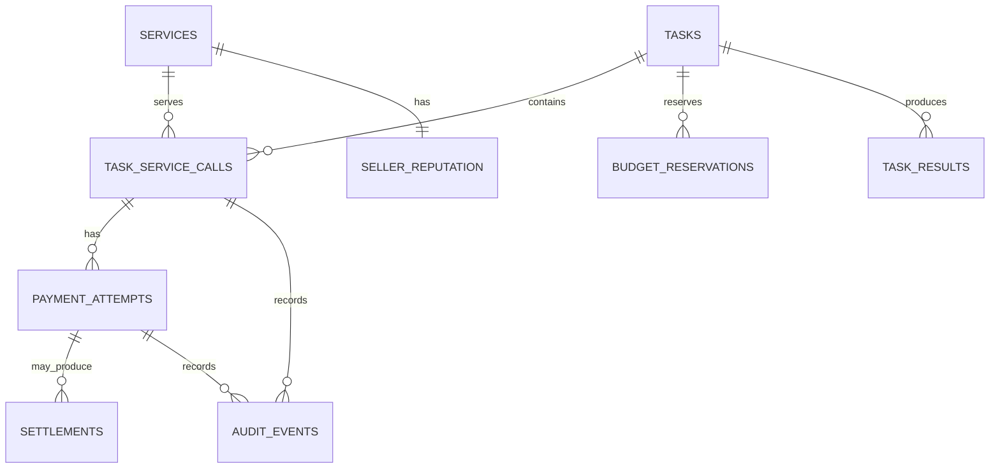

# DI-06: Pay-per-Call Agent Economy
## Database Schema & Data Dictionary

**Document ID:** DI06-DB-001  
**Filename:** `DATABASE_SCHEMA.md`  
**Project:** DI-06 — Pay-per-Call Agent Economy  
**Database:** PostgreSQL  
**Backend baseline:** Python + FastAPI + Pydantic  
**Payment protocol:** x402 v2  
**Settlement network:** Base Sepolia (`eip155:84532`)  
**Status:** Proposed implementation schema — freeze names and enums with the team before implementation

---

## 1. Purpose

This document defines the PostgreSQL data model for the DI-06 solution. It describes the tables, fields, relationships, constraints, indexes, state transitions, persistence rules, and migration workflow needed by the four-person team.

The schema is designed to support:

- Service discovery through a registry.
- Three mandatory seller categories: Data, Scraping, and Inference.
- Buyer tasks, task plans, and multi-service execution.
- Concurrency-safe budget reservations.
- Payment attempts and x402 v2 request lifecycle tracking.
- On-chain settlement evidence and transaction hashes.
- Output-schema validation and paid-but-rejected outcomes.
- Seller reputation statistics.
- A queryable ledger dashboard.
- Auditability and failure recovery.

This is a practical relational baseline for the hackathon, not a claim that the schema is already implemented. Adapt table names to the chosen ORM or migration tool, but keep the shared meaning and status definitions consistent across backend, frontend, and tests.

### 1.1 Design principles

1. **A database row is not proof of on-chain payment.** A call can be marked `paid` only after the implementation has sufficient verified settlement evidence.
2. **Use integer base units for money.** Do not use floating-point arithmetic for USDC budgets, prices, reservations, or totals.
3. **Persist every attempted service call.** Include refused and failed attempts, not only successful payments.
4. **Treat uncertain settlement as a separate state.** A timeout does not necessarily mean a transaction failed.
5. **Enforce safety in transactions and constraints.** Application-level checks alone are not sufficient for concurrent spending.
6. **Keep secrets out of the database.** Do not store private keys, seed phrases, or unnecessary payment authorization material.
7. **Use durable idempotency/replay records.** In-memory-only locks do not survive restarts or coordinate multiple workers.
8. **Separate registry price from actual paid amount.** This makes price manipulation and overcharging visible.
9. **Keep protocol-specific raw data minimal.** Store safe identifiers and hashes needed for audit, not full sensitive headers or credentials.
10. **Make demo data distinguishable from real settlement.** Never seed fake transaction hashes as if they were real.

---

## 2. Scope and Assumptions

### 2.1 In scope

- Service registry and service configuration.
- Tasks and task-level budget.
- Individual service calls.
- Budget reservations.
- Payment attempts and settlement evidence.
- Output validation.
- Seller reputation.
- Audit events and operational status.

### 2.2 Out of scope for the initial implementation

These may be added later if needed, but are not required for the first working version:

- Escrow and refunds.
- Cross-chain settlement.
- A general multi-tenant billing platform.
- Long-term raw evidence storage.
- Advanced user accounts and organizational RBAC.
- Complex subscription or metered pricing.
- Full analytics warehouse.
- A second blockchain network.

### 2.3 Identity assumptions

The schema records a buyer wallet address and seller receiving address. If the application later supports user accounts, add an `users` table and reference it from tasks. For the hackathon baseline, wallet addresses and task identifiers may be sufficient.

### 2.4 Money representation

For a six-decimal USDC asset, one USDC equals `1,000,000` base units. Confirm the selected token's decimals against the verified contract and SDK configuration before implementation.

Use `BIGINT` for base-unit amounts when the maximum supported amount is within its range. Keep decimal strings for API presentation if desired, but convert to integer base units before calculations.

Suggested naming:

- `price_usdc_units`
- `budget_usdc_units`
- `reserved_usdc_units`
- `amount_paid_usdc_units`

Do not mix USDC display decimals and token base units in one column.

---

## 3. Entity Relationship Overview



This is a logical relationship diagram. The final schema may use a separate transaction/ledger table or a combined payment-attempt and settlement design. The recommended baseline below keeps attempts and settlement evidence distinct so an attempt can exist without a successful settlement.

### 3.1 Relationship summary

- One service can be used by many task service calls.
- One task can contain many service calls.
- A task can have multiple budget reservations over its lifetime.
- A service call can have multiple payment attempts if the implementation explicitly supports safe retries; each attempt must be uniquely identifiable.
- A payment attempt may have zero or more settlement observations, but only one canonical successful settlement should be associated with the paid call.
- Each service has one current reputation summary; historical measurements can be added if required.
- A task can produce multiple service-level results and one aggregated final result.
- Audit events can reference a task, service call, or payment attempt.

---

## 4. Table Inventory

| Table | Purpose | Required for baseline |
|---|---|---|
| `services` | Service registry and approved payment configuration | Yes |
| `tasks` | User task, budget and execution state | Yes |
| `task_service_calls` | Each attempted service invocation and result validation | Yes |
| `budget_reservations` | Funds reserved for concurrent service calls | Yes |
| `payment_attempts` | Payment lifecycle, idempotency and failure state | Yes |
| `settlements` | Verified on-chain settlement evidence | Yes |
| `task_results` | Service outputs and aggregated task output | Recommended |
| `seller_reputation` | Current seller success, latency and price statistics | Yes |
| `audit_events` | Important security and lifecycle events | Recommended |
| `schema_migrations` | Migration history | Usually managed by migration tool |

---

## 5. Common Database Conventions

### 5.1 Primary keys

Use UUIDs for application-generated identifiers unless the team has already selected another consistent strategy.

Suggested names:

- `service_id`
- `task_id`
- `call_id`
- `reservation_id`
- `payment_attempt_id`
- `settlement_id`
- `result_id`
- `audit_event_id`

Use UUIDs for internal rows. Keep blockchain transaction hashes as separate fields; do not use transaction hashes as the only primary key for a call.

### 5.2 Timestamps

Store timestamps as PostgreSQL `TIMESTAMPTZ` in UTC. Convert to the user's local timezone only for display.

Common fields:

- `created_at`
- `updated_at`
- `started_at`
- `completed_at`
- `expires_at`
- `verified_at`

### 5.3 JSON fields

Use `JSONB` for flexible input/output schemas, structured task plans, safe error details, and validated results where appropriate. Do not use JSONB to avoid modeling fields that need constraints, joins, uniqueness, or frequent filtering.

### 5.4 Addresses and hashes

Store addresses and transaction hashes as strings with validation in application code. Use case-insensitive comparisons for EVM addresses after normalizing them. Where practical, preserve a normalized lowercase representation for comparison and a display representation separately.

### 5.5 Status values

Use PostgreSQL enum types or `TEXT` with `CHECK` constraints. For a fast-moving hackathon schema, `TEXT` plus check constraints can be easier to migrate. The allowed values must still be centralized in application constants and tests.

---

## 6. Table: `services`

### 6.1 Purpose

Stores each discoverable seller service and its approved price/payment configuration. The buyer uses this record as the trusted reference when checking a seller's payment challenge.

Each of the three mandatory categories must have at least one active service record.

### 6.2 Suggested schema

| Column | Type | Required | Description |
|---|---|---:|---|
| `service_id` | `UUID` | Yes | Primary key |
| `slug` | `TEXT` | Yes | Stable public identifier, e.g. `data-001` |
| `name` | `TEXT` | Yes | Display name |
| `category` | `TEXT` | Yes | `data`, `scraping`, or `inference` |
| `description` | `TEXT` | Yes | Human-readable service description |
| `endpoint_url` | `TEXT` | Yes | Public HTTPS endpoint in deployed environment |
| `price_usdc_units` | `BIGINT` | Yes | Listed per-call price in token base units |
| `network_id` | `TEXT` | Yes | CAIP-2 identifier, e.g. `eip155:84532` |
| `asset_address` | `TEXT` | Yes | Verified token contract address for the network |
| `pay_to_address` | `TEXT` | Yes | Seller's receiving address |
| `input_schema` | `JSONB` | Yes | Declared JSON input schema |
| `output_schema` | `JSONB` | Yes | Declared JSON output schema |
| `capabilities` | `JSONB` | No | Optional tags/capabilities used for discovery |
| `is_active` | `BOOLEAN` | Yes | Whether service is discoverable/selectable |
| `created_at` | `TIMESTAMPTZ` | Yes | Creation time |
| `updated_at` | `TIMESTAMPTZ` | Yes | Last update time |

### 6.3 Constraints

- `slug` must be unique.
- `category` must be one of `data`, `scraping`, `inference`.
- `price_usdc_units` must be greater than or equal to zero; apply the DI-06 per-call price policy in application validation and add a database upper bound if the policy is fixed for the project.
- `network_id` must be from the configured allowlist.
- `asset_address` and `pay_to_address` must pass EVM address validation.
- `endpoint_url` must be a valid URL. Deployed services should use HTTPS.
- Inactive services must not be selected for new calls.
- A service's `pay_to_address`, `asset_address`, and `network_id` must match the actual seller payment configuration.

### 6.4 Indexes

- Unique index on `slug`.
- Index on `(category, is_active)`.
- Index on `(price_usdc_units, is_active)`.
- Optional GIN index on `capabilities` if capability filtering needs it.

### 6.5 Example record

```json
{
  "slug": "data-001",
  "name": "Structured Data Seller",
  "category": "data",
  "description": "Returns validated structured data.",
  "endpoint_url": "https://example.com/services/data-001",
  "price_usdc_units": 2000,
  "network_id": "eip155:84532",
  "asset_address": "0xREPLACE_WITH_VERIFIED_ADDRESS",
  "pay_to_address": "0xREPLACE_WITH_SELLER_ADDRESS",
  "input_schema": {},
  "output_schema": {},
  "is_active": true
}
```

The example values are placeholders. `2000` means `0.002000` USDC only when the verified asset uses six decimals. Do not insert placeholder addresses into a live registry.

---

## 7. Table: `tasks`

### 7.1 Purpose

Stores the buyer's requested task, the budget, task execution status, and aggregate spending.

### 7.2 Suggested schema

| Column | Type | Required | Description |
|---|---|---:|---|
| `task_id` | `UUID` | Yes | Primary key |
| `buyer_address` | `TEXT` | No | Normalized buyer wallet address, if applicable |
| `user_request` | `TEXT` | Yes | Original natural-language task |
| `plan_json` | `JSONB` | No | Structured plan generated by the planner |
| `budget_usdc_units` | `BIGINT` | Yes | Maximum permitted task spend |
| `reserved_usdc_units` | `BIGINT` | Yes | Current amount reserved for in-flight calls |
| `spent_usdc_units` | `BIGINT` | Yes | Confirmed paid amount attributed to the task |
| `max_concurrency` | `INTEGER` | Yes | Maximum simultaneous service calls |
| `status` | `TEXT` | Yes | Task lifecycle status |
| `final_result_json` | `JSONB` | No | Aggregated validated result |
| `failure_reason` | `TEXT` | No | Safe task-level failure summary |
| `created_at` | `TIMESTAMPTZ` | Yes | Creation time |
| `started_at` | `TIMESTAMPTZ` | No | Execution start |
| `completed_at` | `TIMESTAMPTZ` | No | Completion time |
| `updated_at` | `TIMESTAMPTZ` | Yes | Last update |

### 7.3 Task status values

Recommended:

- `queued`
- `planning`
- `running`
- `completed`
- `completed_with_warnings`
- `failed`
- `cancelled`

Keep payment status separate from task status. A task may fail to produce a final answer even though one or more service calls were paid.

### 7.4 Constraints

- `budget_usdc_units >= 0`.
- `reserved_usdc_units >= 0`.
- `spent_usdc_units >= 0`.
- `max_concurrency >= 1`.
- For the required tests, the application configuration must permit `max_concurrency >= 3`.
- `reserved_usdc_units + spent_usdc_units <= budget_usdc_units` should be enforced through transactional logic and, where suitable, a `CHECK` constraint.
- `status` must use the agreed allowed values.

### 7.5 Concurrency note

Do not implement budget reservations as an unprotected sequence of read-then-write operations. Use a database transaction and row-level lock or a single conditional update so two workers cannot reserve the same remaining budget.

A conceptual reservation condition is:

```sql
UPDATE tasks
SET reserved_usdc_units = reserved_usdc_units + :amount,
    updated_at = NOW()
WHERE task_id = :task_id
  AND spent_usdc_units + reserved_usdc_units + :amount <= budget_usdc_units
RETURNING task_id;
```

Run this statement within the appropriate transaction and validate that exactly one row was returned. Release or finalize the reservation consistently when the call's payment outcome is known.

---

## 8. Table: `task_service_calls`

### 8.1 Purpose

Represents each attempt to invoke a seller service. It is the core join between a task, a service, output validation, latency, and payment attempts.

Persist attempts that are refused or fail as well as successful calls.

### 8.2 Suggested schema

| Column | Type | Required | Description |
|---|---|---:|---|
| `call_id` | `UUID` | Yes | Primary key |
| `task_id` | `UUID` | Yes | FK to `tasks` |
| `service_id` | `UUID` | Yes | FK to `services` |
| `call_sequence` | `INTEGER` | Yes | Sequence number within the task |
| `status` | `TEXT` | Yes | Service-call lifecycle status |
| `input_json` | `JSONB` | No | Sanitized input sent to seller |
| `output_json` | `JSONB` | No | Validated output, if accepted |
| `output_schema_valid` | `BOOLEAN` | No | Whether output passed schema validation |
| `validation_error` | `TEXT` | No | Safe validation summary |
| `listed_price_usdc_units` | `BIGINT` | Yes | Registry price at the time of selection |
| `amount_paid_usdc_units` | `BIGINT` | Yes | Confirmed amount paid for this call; zero if confirmed unpaid |
| `latency_ms` | `INTEGER` | No | End-to-end call latency |
| `request_idempotency_key` | `TEXT` | Yes | Stable unique identifier for this call attempt |
| `error_code` | `TEXT` | No | Normalized error code |
| `error_message` | `TEXT` | No | Safe error summary |
| `started_at` | `TIMESTAMPTZ` | No | Start time |
| `completed_at` | `TIMESTAMPTZ` | No | Completion time |
| `created_at` | `TIMESTAMPTZ` | Yes | Creation time |

### 8.3 Call status values

Recommended internal lifecycle:

- `created`
- `awaiting_payment`
- `executing`
- `validating_output`
- `succeeded`
- `paid_output_rejected`
- `refused`
- `failed_and_not_charged`
- `pending_reconciliation`

The UI/ledger should map these to the required visible categories without losing important distinctions. The final shared enum should be frozen in `docs/06_API_CONTRACTS.md`.

### 8.4 Constraints and indexes

- Foreign keys to `tasks` and `services`.
- Unique `(task_id, call_sequence)`.
- Unique `request_idempotency_key` within the intended scope.
- `listed_price_usdc_units >= 0`.
- `amount_paid_usdc_units >= 0`.
- `latency_ms >= 0` when present.
- Index on `(task_id, created_at)`.
- Index on `(service_id, status, created_at)`.
- Index on `(status, created_at)` for operations/ledger views.

### 8.5 Snapshot the listed price

Store `listed_price_usdc_units` at call creation. Do not rely only on the current `services.price_usdc_units`, because the registry price may change later. Historical call records must preserve the price against which the buyer made its decision.

### 8.6 Sensitive payload policy

Store only the minimum data needed for reproducibility and debugging. Scraped content or user inputs may contain personal or sensitive information; define retention and redaction rules. Never store private keys or raw payment authorization headers in `input_json`, `output_json`, or error messages.

---

## 9. Table: `budget_reservations`

### 9.1 Purpose

Tracks funds reserved for in-flight calls so concurrent requests cannot collectively exceed the task budget.

### 9.2 Suggested schema

| Column | Type | Required | Description |
|---|---|---:|---|
| `reservation_id` | `UUID` | Yes | Primary key |
| `task_id` | `UUID` | Yes | FK to `tasks` |
| `call_id` | `UUID` | Yes | FK to `task_service_calls` |
| `amount_usdc_units` | `BIGINT` | Yes | Reserved amount in base units |
| `status` | `TEXT` | Yes | Reservation lifecycle status |
| `created_at` | `TIMESTAMPTZ` | Yes | Reservation creation |
| `expires_at` | `TIMESTAMPTZ` | No | Optional lease expiry for recovery |
| `finalized_at` | `TIMESTAMPTZ` | No | Reservation finalization time |

### 9.3 Reservation statuses

- `reserved`
- `consumed`
- `released`
- `expired`

### 9.4 Rules

- A reservation must be created before the buyer authorizes spending for the call.
- A successful confirmed payment converts the reservation to consumed and increments task spend exactly once.
- A confirmed refusal/failure without charge releases the reservation.
- A timeout or uncertain settlement must not immediately release the reservation if doing so could allow overspending; reconcile first or retain it in a clearly managed pending state.
- The same reservation must not be consumed or released twice.
- Enforce at most one active reservation per call using a partial unique index where supported, or equivalent transactional logic.
- A recovery process should detect stale reservations and reconcile their payment outcomes before releasing them.

### 9.5 Indexes

- Index on `(task_id, status)`.
- Unique index on `call_id` if the design permits only one reservation per call.
- Index on `expires_at` for recovery scans of stale reservations.

---

## 10. Table: `payment_attempts`

### 10.1 Purpose

Records the payment lifecycle for an individual service call. This table is separate from `settlements`: an attempt can be refused or fail before any on-chain transfer occurs.

### 10.2 Suggested schema

| Column | Type | Required | Description |
|---|---|---:|---|
| `payment_attempt_id` | `UUID` | Yes | Primary key |
| `call_id` | `UUID` | Yes | FK to `task_service_calls` |
| `attempt_number` | `INTEGER` | Yes | Attempt sequence for the call |
| `idempotency_key` | `TEXT` | Yes | Durable deduplication key |
| `protocol_version` | `TEXT` | Yes | Expected value such as `x402-v2` |
| `network_id` | `TEXT` | Yes | Expected CAIP-2 network |
| `asset_address` | `TEXT` | Yes | Expected payment token contract |
| `pay_to_address` | `TEXT` | Yes | Expected seller receiving address |
| `requested_amount_usdc_units` | `BIGINT` | Yes | Amount requested by the seller/challenge |
| `approved_amount_usdc_units` | `BIGINT` | No | Amount approved after policy checks |
| `status` | `TEXT` | Yes | Payment attempt status |
| `challenge_fingerprint` | `TEXT` | No | Safe fingerprint of the challenge, not raw credentials |
| `transaction_hash` | `TEXT` | No | Hash once known, if the chosen flow exposes it |
| `failure_code` | `TEXT` | No | Normalized failure reason |
| `failure_message` | `TEXT` | No | Safe failure summary |
| `created_at` | `TIMESTAMPTZ` | Yes | Attempt creation |
| `updated_at` | `TIMESTAMPTZ` | Yes | Last update |
| `verified_at` | `TIMESTAMPTZ` | No | Verification time |
| `settled_at` | `TIMESTAMPTZ` | No | Settlement time, if confirmed |

### 10.3 Payment attempt statuses

Recommended:

- `created`
- `challenge_received`
- `policy_rejected`
- `authorization_created`
- `verification_pending`
- `settlement_pending`
- `settled`
- `failed_before_settlement`
- `pending_reconciliation`

Do not mark an attempt `settled` solely because a seller returned a successful HTTP status. Link it to verified settlement evidence.

### 10.4 Constraints and indexes

- Unique `(call_id, attempt_number)`.
- Unique `idempotency_key` within its intended scope.
- `requested_amount_usdc_units >= 0`.
- `approved_amount_usdc_units >= 0` when present.
- Index on `(status, created_at)`.
- Index on `transaction_hash` when present.
- Index on `call_id`.

### 10.5 Replay and idempotency

A payment attempt must be uniquely scoped to the call and authorization lifecycle. The application should atomically claim/consume the relevant idempotency key before permitting the protected response. Exact key semantics depend on the chosen x402 v2 SDK and protocol lifecycle.

Do not store private authorization payloads merely to detect replay. Prefer durable unique identifiers or safe fingerprints supported by the implementation. Ensure that duplicate sequential and concurrent requests cannot produce multiple successful paid responses or duplicate settlements.

---

## 11. Table: `settlements`

### 11.1 Purpose

Stores verified on-chain evidence of settlement. Keep this separate from the payment attempt so the database can represent a refused or pending attempt without falsely claiming a transfer occurred.

### 11.2 Suggested schema

| Column | Type | Required | Description |
|---|---|---:|---|
| `settlement_id` | `UUID` | Yes | Primary key |
| `payment_attempt_id` | `UUID` | Yes | FK to `payment_attempts` |
| `network_id` | `TEXT` | Yes | Chain/network identifier |
| `transaction_hash` | `TEXT` | Yes | Transaction hash |
| `token_address` | `TEXT` | Yes | Token contract address |
| `from_address` | `TEXT` | No | Payer address if verified and available |
| `to_address` | `TEXT` | Yes | Verified recipient |
| `amount_usdc_units` | `BIGINT` | Yes | Verified transfer amount in base units |
| `block_number` | `BIGINT` | No | Confirmed block number |
| `transaction_index` | `INTEGER` | No | Transaction index if available |
| `status` | `TEXT` | Yes | Verification status |
| `verification_source` | `TEXT` | No | RPC/provider or SDK verification method |
| `verified_at` | `TIMESTAMPTZ` | No | Verification timestamp |
| `created_at` | `TIMESTAMPTZ` | Yes | Record creation |

### 11.3 Settlement statuses

Recommended:

- `observed`
- `confirmed`
- `reverted`
- `verification_failed`

The application should define when a transaction is considered sufficiently confirmed for the demo. Do not confuse “broadcast” with “confirmed.”

### 11.4 Constraints and indexes

- Unique `(network_id, transaction_hash)` to avoid recording the same chain transaction twice.
- `amount_usdc_units >= 0`.
- Index on `payment_attempt_id`.
- Index on `(network_id, transaction_hash)`.
- Index on `(status, created_at)`.

### 11.5 Reconciliation rules

Before a call is marked paid:

1. Confirm the network.
2. Confirm the transaction hash is valid for that network.
3. Confirm the expected token contract.
4. Confirm the recipient.
5. Confirm the amount.
6. Confirm the transaction outcome according to the chosen settlement policy.
7. Link the verified settlement to the payment attempt and service call.
8. Update task spend exactly once.

If the transaction outcome is uncertain, retain a pending state and reconcile before retrying. A transaction hash by itself does not prove that the intended transfer succeeded.

---

## 12. Table: `task_results`

### 12.1 Purpose

Stores accepted service-level results and/or the final aggregated task result. It may be omitted if the implementation stores all validated results directly in `task_service_calls.output_json` and the task's `final_result_json`; however, a separate table is useful when there are multiple outputs, larger payloads, or distinct result provenance requirements.

### 12.2 Suggested schema

| Column | Type | Required | Description |
|---|---|---:|---|
| `result_id` | `UUID` | Yes | Primary key |
| `task_id` | `UUID` | Yes | FK to `tasks` |
| `call_id` | `UUID` | No | FK to `task_service_calls`; null for final aggregate |
| `result_type` | `TEXT` | Yes | `service_output` or `task_aggregate` |
| `payload_json` | `JSONB` | Yes | Validated structured output |
| `schema_valid` | `BOOLEAN` | Yes | Whether declared schema validation passed |
| `is_accepted` | `BOOLEAN` | Yes | Whether the buyer accepted the result |
| `created_at` | `TIMESTAMPTZ` | Yes | Creation time |

### 12.3 Rules

- Never treat invalid output as accepted.
- If a service output is invalid after payment has settled, preserve the payment fact and mark the output as rejected.
- Do not expose raw, unvalidated seller output to the frontend as trusted content.
- If payload size becomes large, store a reference to external object storage rather than placing arbitrarily large blobs in JSONB.

---

## 13. Table: `seller_reputation`

### 13.1 Purpose

Stores the current reputation summary used by the buyer and displayed in the marketplace.

### 13.2 Suggested schema

| Column | Type | Required | Description |
|---|---|---:|---|
| `service_id` | `UUID` | Yes | PK and FK to `services` |
| `total_calls` | `BIGINT` | Yes | Number of counted service attempts |
| `successful_calls` | `BIGINT` | Yes | Calls producing accepted valid output |
| `paid_output_rejected_calls` | `BIGINT` | Yes | Paid calls whose output was rejected |
| `failed_calls` | `BIGINT` | Yes | Failed calls; define treatment of refusals consistently |
| `success_rate` | `NUMERIC(6,5)` | Yes | Derived or cached success rate from 0 to 1 |
| `median_latency_ms` | `BIGINT` | No | Median observed latency |
| `current_listed_price_usdc_units` | `BIGINT` | Yes | Current registry price snapshot |
| `last_call_at` | `TIMESTAMPTZ` | No | Most recent counted call |
| `updated_at` | `TIMESTAMPTZ` | Yes | Last aggregate refresh |

### 13.3 Rules

- Define a consistent denominator for `success_rate`.
- Do not count policy-refused calls as seller failures unless the team explicitly chooses and documents that rule.
- Invalid output must lower the relevant seller success metric.
- Median latency should be calculated from persisted call records or updated by a reliable aggregation process.
- Reputation must not be trusted as an authorization mechanism; it informs ranking only.
- If no calls exist, display “No history yet” instead of misleadingly presenting a 100% success rate.

### 13.4 Calculation policy

For example:

```text
success_rate = successful_calls / eligible_completed_calls
```

The team must define `eligible_completed_calls` in one place and use it consistently in the backend and UI. A paid-but-rejected output should count as a failed accepted-result outcome, while the payment itself remains recorded as paid.

---

## 14. Table: `audit_events`

### 14.1 Purpose

Captures important state changes and security-relevant decisions for debugging and demonstration. It should not contain secrets.

### 14.2 Suggested schema

| Column | Type | Required | Description |
|---|---|---:|---|
| `audit_event_id` | `UUID` | Yes | Primary key |
| `task_id` | `UUID` | No | Related task |
| `call_id` | `UUID` | No | Related service call |
| `payment_attempt_id` | `UUID` | No | Related payment attempt |
| `event_type` | `TEXT` | Yes | Stable event name |
| `actor_type` | `TEXT` | Yes | `buyer`, `seller`, `system`, or `operator` |
| `actor_id` | `TEXT` | No | Safe actor/service identifier |
| `event_data` | `JSONB` | No | Sanitized event details |
| `created_at` | `TIMESTAMPTZ` | Yes | Event timestamp |

### 14.3 Example event types

- `task_created`
- `service_selected`
- `budget_reserved`
- `payment_policy_rejected`
- `payment_challenge_received`
- `payment_verification_started`
- `settlement_confirmed`
- `output_validation_failed`
- `fallback_selected`
- `budget_reservation_released`
- `task_completed`

### 14.4 Logging restrictions

Do not store private keys, seed phrases, full authorization headers, or raw secrets in `event_data`. Keep error details short, sanitized, and useful for debugging.

---

## 15. State Transitions

### 15.1 Service-call lifecycle

```text
created
  |
  v
awaiting_payment
  |--------------------------|
  |                          |
  v                          v
refused              executing / validating_output
                              |
                 +------------+------------+
                 |            |            |
                 v            v            v
             succeeded   paid_output_   failed_and_
                          rejected     not_charged

Any uncertain payment outcome may enter:
pending_reconciliation
```

The diagram is illustrative. The exact transition order must match the chosen x402 v2 SDK lifecycle. For example, if settlement can occur before the buyer receives and validates the output, the system must represent the resulting paid-but-rejected case correctly rather than pretending the call was unpaid.

### 15.2 Payment-attempt lifecycle

```text
created
  |
  v
challenge_received
  |
  v
policy checks
  |----------------------|
  |                      |
  v                      v
policy_rejected    authorization_created
                         |
                         v
                  verification_pending
                         |
                         v
                  settlement_pending
                    |          |
                    v          v
                 settled   pending_reconciliation
```

Some SDKs combine or abstract these stages. Persist the states the implementation can observe reliably; do not invent events the SDK does not expose.

### 15.3 Budget-reservation lifecycle

```text
reserved
  |-----------------------------|
  |               |             |
  v               v             v
consumed        released       expires
```

Do not automatically release a reservation solely because a request timed out if payment may have been broadcast. Reconcile first.

---

## 16. Transactional Rules and Invariants

These invariants should be enforced in application logic and supported by database constraints wherever possible.

### 16.1 Budget invariant

For each task:

```text
confirmed_spend + active_reservations <= task_budget
```

Use one database transaction for reservation creation and task aggregate updates. Prevent duplicate consumption of the same reservation.

### 16.2 One settlement per payment attempt

A payment attempt should have at most one canonical successful settlement record. If multiple chain events or provider observations are received, deduplicate by `(network_id, transaction_hash)` and reconcile them rather than counting them as multiple payments.

### 16.3 Idempotent spending

A retried API request must not increment task spend twice. Use unique idempotency keys and transactional updates. The exact replay key must align with the payment authorization/call semantics.

### 16.4 Settlement evidence

A service call may be recorded as `paid` only when the implementation has verified the intended settlement outcome. An HTTP 200 response or a transaction hash string alone is not enough.

### 16.5 Invalid output after payment

If settlement has succeeded but the seller output fails schema validation:

- Preserve the settlement.
- Record the call as `paid_output_rejected`.
- Set `output_schema_valid = false`.
- Record a safe validation reason.
- Update seller reputation accordingly.
- Allow fallback only if budget policy permits it.

### 16.6 Price snapshot

Store the registry-listed price on the call. Store the requested and approved amounts on the payment attempt. Store the verified actual amount in the settlement. These fields support comparisons and audits.

---

## 17. Suggested PostgreSQL DDL Skeleton

This section gives a compact starting point for the core schema. It is illustrative DDL and should be adapted to the selected migration system and PostgreSQL version. UUID generation can be handled by the application or a database extension approved by the team.

```sql
CREATE TABLE services (
    service_id UUID PRIMARY KEY,
    slug TEXT NOT NULL UNIQUE,
    name TEXT NOT NULL,
    category TEXT NOT NULL CHECK (category IN ('data', 'scraping', 'inference')),
    description TEXT NOT NULL,
    endpoint_url TEXT NOT NULL,
    price_usdc_units BIGINT NOT NULL CHECK (price_usdc_units >= 0),
    network_id TEXT NOT NULL,
    asset_address TEXT NOT NULL,
    pay_to_address TEXT NOT NULL,
    input_schema JSONB NOT NULL,
    output_schema JSONB NOT NULL,
    capabilities JSONB,
    is_active BOOLEAN NOT NULL DEFAULT TRUE,
    created_at TIMESTAMPTZ NOT NULL DEFAULT NOW(),
    updated_at TIMESTAMPTZ NOT NULL DEFAULT NOW()
);

CREATE INDEX idx_services_category_active
    ON services(category, is_active);

CREATE INDEX idx_services_price_active
    ON services(price_usdc_units, is_active);


CREATE TABLE tasks (
    task_id UUID PRIMARY KEY,
    buyer_address TEXT,
    user_request TEXT NOT NULL,
    plan_json JSONB,
    budget_usdc_units BIGINT NOT NULL CHECK (budget_usdc_units >= 0),
    reserved_usdc_units BIGINT NOT NULL DEFAULT 0 CHECK (reserved_usdc_units >= 0),
    spent_usdc_units BIGINT NOT NULL DEFAULT 0 CHECK (spent_usdc_units >= 0),
    max_concurrency INTEGER NOT NULL DEFAULT 3 CHECK (max_concurrency >= 1),
    status TEXT NOT NULL CHECK (
        status IN ('queued', 'planning', 'running', 'completed',
                   'completed_with_warnings', 'failed', 'cancelled')
    ),
    final_result_json JSONB,
    failure_reason TEXT,
    created_at TIMESTAMPTZ NOT NULL DEFAULT NOW(),
    started_at TIMESTAMPTZ,
    completed_at TIMESTAMPTZ,
    updated_at TIMESTAMPTZ NOT NULL DEFAULT NOW(),
    CHECK (reserved_usdc_units + spent_usdc_units <= budget_usdc_units)
);


CREATE TABLE task_service_calls (
    call_id UUID PRIMARY KEY,
    task_id UUID NOT NULL REFERENCES tasks(task_id),
    service_id UUID NOT NULL REFERENCES services(service_id),
    call_sequence INTEGER NOT NULL CHECK (call_sequence >= 1),
    status TEXT NOT NULL CHECK (
        status IN ('created', 'awaiting_payment', 'executing',
                   'validating_output', 'succeeded', 'paid_output_rejected',
                   'refused', 'failed_and_not_charged', 'pending_reconciliation')
    ),
    input_json JSONB,
    output_json JSONB,
    output_schema_valid BOOLEAN,
    validation_error TEXT,
    listed_price_usdc_units BIGINT NOT NULL CHECK (listed_price_usdc_units >= 0),
    amount_paid_usdc_units BIGINT NOT NULL DEFAULT 0 CHECK (amount_paid_usdc_units >= 0),
    latency_ms INTEGER CHECK (latency_ms >= 0),
    request_idempotency_key TEXT NOT NULL UNIQUE,
    error_code TEXT,
    error_message TEXT,
    started_at TIMESTAMPTZ,
    completed_at TIMESTAMPTZ,
    created_at TIMESTAMPTZ NOT NULL DEFAULT NOW(),
    UNIQUE (task_id, call_sequence)
);


CREATE TABLE budget_reservations (
    reservation_id UUID PRIMARY KEY,
    task_id UUID NOT NULL REFERENCES tasks(task_id),
    call_id UUID NOT NULL UNIQUE REFERENCES task_service_calls(call_id),
    amount_usdc_units BIGINT NOT NULL CHECK (amount_usdc_units >= 0),
    status TEXT NOT NULL CHECK (status IN ('reserved', 'consumed', 'released', 'expired')),
    created_at TIMESTAMPTZ NOT NULL DEFAULT NOW(),
    expires_at TIMESTAMPTZ,
    finalized_at TIMESTAMPTZ
);

CREATE INDEX idx_reservations_task_status
    ON budget_reservations(task_id, status);


CREATE TABLE payment_attempts (
    payment_attempt_id UUID PRIMARY KEY,
    call_id UUID NOT NULL REFERENCES task_service_calls(call_id),
    attempt_number INTEGER NOT NULL CHECK (attempt_number >= 1),
    idempotency_key TEXT NOT NULL UNIQUE,
    protocol_version TEXT NOT NULL,
    network_id TEXT NOT NULL,
    asset_address TEXT NOT NULL,
    pay_to_address TEXT NOT NULL,
    requested_amount_usdc_units BIGINT NOT NULL CHECK (requested_amount_usdc_units >= 0),
    approved_amount_usdc_units BIGINT CHECK (approved_amount_usdc_units >= 0),
    status TEXT NOT NULL CHECK (
        status IN ('created', 'challenge_received', 'policy_rejected',
                   'authorization_created', 'verification_pending',
                   'settlement_pending', 'settled', 'failed_before_settlement',
                   'pending_reconciliation')
    ),
    challenge_fingerprint TEXT,
    transaction_hash TEXT,
    failure_code TEXT,
    failure_message TEXT,
    created_at TIMESTAMPTZ NOT NULL DEFAULT NOW(),
    updated_at TIMESTAMPTZ NOT NULL DEFAULT NOW(),
    verified_at TIMESTAMPTZ,
    settled_at TIMESTAMPTZ,
    UNIQUE (call_id, attempt_number)
);

CREATE INDEX idx_payment_attempts_status_created
    ON payment_attempts(status, created_at);

CREATE INDEX idx_payment_attempts_tx_hash
    ON payment_attempts(transaction_hash);


CREATE TABLE settlements (
    settlement_id UUID PRIMARY KEY,
    payment_attempt_id UUID NOT NULL REFERENCES payment_attempts(payment_attempt_id),
    network_id TEXT NOT NULL,
    transaction_hash TEXT NOT NULL,
    token_address TEXT NOT NULL,
    from_address TEXT,
    to_address TEXT NOT NULL,
    amount_usdc_units BIGINT NOT NULL CHECK (amount_usdc_units >= 0),
    block_number BIGINT,
    transaction_index INTEGER,
    status TEXT NOT NULL CHECK (
        status IN ('observed', 'confirmed', 'reverted', 'verification_failed')
    ),
    verification_source TEXT,
    verified_at TIMESTAMPTZ,
    created_at TIMESTAMPTZ NOT NULL DEFAULT NOW(),
    UNIQUE (network_id, transaction_hash)
);

CREATE INDEX idx_settlements_attempt
    ON settlements(payment_attempt_id);


CREATE TABLE task_results (
    result_id UUID PRIMARY KEY,
    task_id UUID NOT NULL REFERENCES tasks(task_id),
    call_id UUID REFERENCES task_service_calls(call_id),
    result_type TEXT NOT NULL CHECK (result_type IN ('service_output', 'task_aggregate')),
    payload_json JSONB NOT NULL,
    schema_valid BOOLEAN NOT NULL,
    is_accepted BOOLEAN NOT NULL,
    created_at TIMESTAMPTZ NOT NULL DEFAULT NOW()
);

CREATE INDEX idx_task_results_task_created
    ON task_results(task_id, created_at);


CREATE TABLE seller_reputation (
    service_id UUID PRIMARY KEY REFERENCES services(service_id),
    total_calls BIGINT NOT NULL DEFAULT 0 CHECK (total_calls >= 0),
    successful_calls BIGINT NOT NULL DEFAULT 0 CHECK (successful_calls >= 0),
    paid_output_rejected_calls BIGINT NOT NULL DEFAULT 0 CHECK (paid_output_rejected_calls >= 0),
    failed_calls BIGINT NOT NULL DEFAULT 0 CHECK (failed_calls >= 0),
    success_rate NUMERIC(6,5) NOT NULL DEFAULT 0 CHECK (success_rate >= 0 AND success_rate <= 1),
    median_latency_ms BIGINT CHECK (median_latency_ms >= 0),
    current_listed_price_usdc_units BIGINT NOT NULL DEFAULT 0 CHECK (current_listed_price_usdc_units >= 0),
    last_call_at TIMESTAMPTZ,
    updated_at TIMESTAMPTZ NOT NULL DEFAULT NOW()
);


CREATE TABLE audit_events (
    audit_event_id UUID PRIMARY KEY,
    task_id UUID REFERENCES tasks(task_id),
    call_id UUID REFERENCES task_service_calls(call_id),
    payment_attempt_id UUID REFERENCES payment_attempts(payment_attempt_id),
    event_type TEXT NOT NULL,
    actor_type TEXT NOT NULL CHECK (actor_type IN ('buyer', 'seller', 'system', 'operator')),
    actor_id TEXT,
    event_data JSONB,
    created_at TIMESTAMPTZ NOT NULL DEFAULT NOW()
);

CREATE INDEX idx_audit_events_task_created
    ON audit_events(task_id, created_at);

CREATE INDEX idx_audit_events_type_created
    ON audit_events(event_type, created_at);
```

### 17.1 Important DDL implementation notes

- Generate UUIDs consistently in the application or through an approved PostgreSQL UUID-generation function.
- Validate EVM addresses in application code; a `TEXT` column does not validate address syntax.
- The DDL's `CHECK (reserved_usdc_units + spent_usdc_units <= budget_usdc_units)` is useful, but it does not replace transactional reservation logic.
- Ensure task spend is incremented exactly once when a reservation becomes consumed.
- If `task_service_calls.amount_paid_usdc_units` is cached, define one transaction that updates it alongside the settlement and task totals.
- If a single payment attempt can have several transaction observations, separate observations from the canonical settlement or add a transaction-events table. Do not count duplicate observations as separate paid calls.
- If an ORM uses different column names, keep the API/data dictionary meanings equivalent.
- If the database migration uses an extension for UUIDs, enable it through an explicit migration and document it.

---

## 18. Migration Strategy

Use a version-controlled migration tool. If the team uses SQLAlchemy, Alembic is a common option; otherwise use the migration mechanism that matches the selected data-access layer.

### 18.1 Migration rules

1. Every schema change must be committed as a migration.
2. Do not manually modify a shared or deployed database schema without a migration.
3. Test migrations against a fresh database.
4. Keep migrations small and reviewable.
5. Do not rewrite an already-applied migration; create a new migration.
6. Seed data should be repeatable and should not create duplicate service rows on every run.
7. Destructive migrations require explicit team agreement.
8. Keep schema changes synchronized with Pydantic models, API contracts, and frontend types.

### 18.2 Suggested migration sequence

```text
001_create_services
002_create_tasks
003_create_task_service_calls
004_create_budget_reservations
005_create_payment_attempts
006_create_settlements
007_create_task_results
008_create_seller_reputation
009_create_audit_events
010_add_required_indexes_and_constraints
```

The actual migration tool may combine some of these into fewer migrations. The sequence above is a planning aid.

### 18.3 Seed data

Seed exactly the active services needed for the demo, including at least one Data, Scraping, and Inference seller. Make seeding idempotent by using stable slugs and an upsert strategy.

Do not seed fake settlement rows. Unit-test fixtures may use clearly marked mock data in an isolated test database, but it must never be presented as real testnet settlement in the demo.

---

## 19. Data Retention, Privacy and Operational Hygiene

- Keep only the input/output content required for the demo and debugging.
- Redact sensitive or unnecessary data from seller outputs before persistence.
- Do not store private keys, seed phrases, or full payment authorization headers.
- Avoid storing full scraped pages when a compact normalized result is sufficient.
- Define whether task inputs and results are deleted after a demo or retained.
- Restrict database credentials to the backend service.
- Use TLS and provider-managed secret storage for hosted database connections where available.
- Avoid exposing raw database errors to the frontend.
- Keep an audit trail for important payment decisions without logging secret material.
- Use separate development and deployed databases.

---

## 20. Ledger Query Examples

These examples support the dashboard and should be adapted to the final column names.

### 20.1 Recent calls with service information

```sql
SELECT
    c.call_id,
    c.task_id,
    s.slug AS service_slug,
    s.name AS service_name,
    s.category,
    c.status,
    c.listed_price_usdc_units,
    c.amount_paid_usdc_units,
    c.latency_ms,
    c.created_at
FROM task_service_calls AS c
JOIN services AS s ON s.service_id = c.service_id
ORDER BY c.created_at DESC
LIMIT 100;
```

### 20.2 Recent verified settlements

```sql
SELECT
    se.network_id,
    se.transaction_hash,
    se.token_address,
    se.to_address,
    se.amount_usdc_units,
    se.status,
    se.verified_at,
    pa.call_id,
    s.slug AS service_slug
FROM settlements AS se
JOIN payment_attempts AS pa
  ON pa.payment_attempt_id = se.payment_attempt_id
JOIN task_service_calls AS c
  ON c.call_id = pa.call_id
JOIN services AS s
  ON s.service_id = c.service_id
WHERE se.status = 'confirmed'
ORDER BY se.verified_at DESC
LIMIT 100;
```

### 20.3 Service success and latency summary

For production-quality statistics, compute medians from persisted call records and define the eligible-call denominator explicitly. A simplified example:

```sql
SELECT
    s.slug,
    s.name,
    COUNT(c.call_id) AS total_calls,
    COUNT(*) FILTER (WHERE c.status = 'succeeded') AS successful_calls,
    COUNT(*) FILTER (WHERE c.status = 'paid_output_rejected') AS rejected_paid_outputs,
    percentile_cont(0.5) WITHIN GROUP (ORDER BY c.latency_ms)
        FILTER (WHERE c.latency_ms IS NOT NULL) AS median_latency_ms
FROM services AS s
LEFT JOIN task_service_calls AS c
  ON c.service_id = s.service_id
GROUP BY s.service_id, s.slug, s.name
ORDER BY s.name;
```

This query is illustrative. Confirm that the selected PostgreSQL version supports the aggregate/filter syntax used, and make the success-rate denominator explicit in application code or a view.

### 20.4 Calls requiring reconciliation

```sql
SELECT
    pa.payment_attempt_id,
    pa.call_id,
    pa.network_id,
    pa.transaction_hash,
    pa.status,
    pa.created_at,
    pa.updated_at
FROM payment_attempts AS pa
WHERE pa.status = 'pending_reconciliation'
ORDER BY pa.created_at ASC;
```

---

## 21. Database Test Checklist

### Registry
- [ ] Duplicate service slug is rejected.
- [ ] Invalid category is rejected.
- [ ] Negative price is rejected.
- [ ] Inactive service is not selected by the buyer.
- [ ] Registry `pay_to_address`, token and network match the seller configuration.
- [ ] Search/filter by category and price works.

### Tasks and budgets
- [ ] Negative budget is rejected.
- [ ] Concurrent reservations cannot overspend.
- [ ] A reservation cannot be consumed twice.
- [ ] A released reservation does not count as spend.
- [ ] A pending/uncertain payment does not free budget prematurely.
- [ ] Task spend is updated exactly once.

### Service calls and payment attempts
- [ ] Every attempted call is persisted.
- [ ] Refused calls are persisted.
- [ ] Failed calls are persisted.
- [ ] Duplicate idempotency keys are rejected or safely deduplicated.
- [ ] Price snapshots remain unchanged if registry price later changes.
- [ ] Raw secrets are not stored in call inputs, outputs, or errors.

### Settlements and ledger
- [ ] Duplicate `(network_id, transaction_hash)` is rejected.
- [ ] A transaction is marked confirmed only after verification.
- [ ] Token, recipient, network and amount are checked.
- [ ] A paid output rejected by schema validation remains recorded as paid.
- [ ] Ledger rows reconcile with on-chain evidence.
- [ ] An uncertain transaction can be reconciled without duplicate payment.

### Reputation and audit
- [ ] Invalid seller output affects reputation.
- [ ] Policy refusals are not incorrectly counted as seller failures.
- [ ] Median latency ignores missing latency values.
- [ ] Audit events contain no secrets.
- [ ] A service with no history is shown as having no history rather than a misleading perfect score.

---

## 22. Decisions to Freeze Before Coding

The team should confirm these decisions in the kickoff meeting and record them in the API contract document:

1. UUID generation strategy.
2. Whether service slugs or UUIDs are used in public API routes.
3. Exact service categories and allowed values.
4. Exact task, call, payment and settlement status enums.
5. USDC amount unit conventions and verified token decimals.
6. Whether `task_results` is a separate table or outputs remain in call/task rows.
7. Which database access layer and migration tool are used.
8. The definition of a confirmed settlement for the demo.
9. How idempotency keys are generated and scoped.
10. How pending reservations are reconciled after timeout/restart.
11. Which fields are retained or redacted for user inputs and seller outputs.
12. Whether a user/account table is needed for the first version.
13. Which component is authoritative for updating task spend.
14. How reputation's success-rate denominator is calculated.
15. Which API response statuses the frontend will display.

Do not let different team members independently define these choices.

---

## 23. Recommended Implementation Order

1. Create the `services` table and seed one record for each required category.
2. Create `tasks` and `task_service_calls`.
3. Add `budget_reservations` with atomic reservation logic.
4. Add `payment_attempts` and durable idempotency constraints.
5. Add `settlements` and verified transaction reconciliation.
6. Add `task_results` if separate result provenance is needed.
7. Add `seller_reputation`.
8. Add `audit_events`.
9. Build ledger queries and frontend display.
10. Run concurrency, replay, price-manipulation, seller-failure, and settlement-reconciliation tests.

Prioritize the smallest correct schema that supports a real paid call and a reliable ledger. Add optional fields only when they serve a documented use case.

---

## 24. Final Acceptance Criteria

The database design is ready for implementation when:

- [ ] All four team members agree on table names and core field meanings.
- [ ] Shared API schemas match the database model.
- [ ] The three required seller categories can be represented in the registry.
- [ ] Every attempted service call can be traced to a task and service.
- [ ] Every payment attempt can be traced to a call.
- [ ] Verified settlement evidence is stored separately from an attempt.
- [ ] Amounts use integer base units for arithmetic.
- [ ] Budget reservations are concurrency-safe and idempotent.
- [ ] Uncertain payment outcomes remain distinguishable from confirmed unpaid failures.
- [ ] The ledger can show status, listed price, amount paid, latency, and transaction hash.
- [ ] Reputation can be computed from persisted call outcomes.
- [ ] Migrations can create the schema from a clean database.
- [ ] Seed scripts are repeatable and do not create fake settlements.
- [ ] Tests cover duplicate/replayed requests, budget races, and ledger reconciliation.
- [ ] No private keys or secret payment material are stored in the schema.

---

## Final Rule

**Keep the registry price, requested payment, approved payment, and verified settlement amount as separate facts. Keep budget reservations durable and concurrency-safe. Never treat an API response or an unverified transaction hash as proof of settlement.**

Those rules are essential to make the DI-06 ledger auditable and the payment system safe under retries, failures, and parallel requests.
