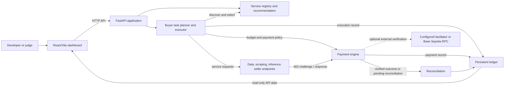

# DI-06 AgentMarketplace

DI-06 is a pay-per-call agent marketplace prototype. It combines a React/Vite dashboard with a FastAPI service for agent discovery, buyer task execution, seller endpoints, payment policy and budget handling, and a persistent audit ledger.

The repository is a development and hackathon project. Local seller providers default to fake/demo mode. A returned HTTP success, a local authorization, or a UI status does not prove an on-chain settlement.

## Project overview

- **Frontend:** React 18, TypeScript, Vite, and Tailwind CSS in `frontend/`.
- **Backend:** FastAPI/Uvicorn application in `backend/main.py`.
- **Buyer and registry:** Buyer task planning/execution and service discovery under `backend/buyer/` and `backend/registry/`.
- **Seller categories:** Data, scraping, and inference endpoints. The provider configuration defaults to `SELLER_PROVIDER_MODE=fake`; live upstream providers require separately configured credentials and network access.
- **Marketplace catalogue:** Nine registered profiles (three per category). The six additional profiles are local reference profiles routed to the existing category endpoint; they are not independent providers.
- **Recommendation:** `POST /api/v1/services/recommendations` ranks candidates after category, capability, budget, declared-latency, and evidence-availability checks. Historical rates are based on ledger records; a profile with no observed history is labelled `NEW`. This is a prototype strategy, not a guarantee of semantic correctness or future performance.
- **Payment handling:** Payment policy, integer base-unit budget reservation, idempotency, settlement classification, and reconciliation code live under `backend/payments/`. External facilitator/RPC verification requires valid configuration and connectivity. Do not treat an HTTP 200 response by itself as proof of settlement.
- **Ledger:** The ledger and reconciliation APIs record payment outcomes and supporting evidence. Local SQLite is the default development database; production configuration requires PostgreSQL.

## Architecture



Local fake seller providers can return synthetic service data. The dotted external verification connection is environment-dependent; the default startup does not broadcast a transaction.

## Features and routes

Implemented application areas include:

- **Dashboard:** `/dashboard`
- **Marketplace:** `/marketplace` — registry-backed listing, search, category/price filters, and recommendation inspection.
- **Buyer Console:** `/buyer` — task and budget submission.
- **Execution:** `/execution` and `/execution/{task_id}`
- **Payment inspection:** `/payments`
- **Results and provenance:** `/results` and `/results/{task_id}`
- **Ledger:** `/ledger`
- **Additional pages:** seller tools, analytics, docs, and protocol/about views.

Useful API routes include:

| Route | Purpose |
| --- | --- |
| `GET /health` | API and database health |
| `GET /api/v1/services` | List/filter registered services |
| `GET /api/v1/services/{service_id}` | Read one service profile |
| `POST /api/v1/services/recommendations` | Filter and rank recommendation candidates; does not initiate payment |
| `POST /api/v1/buyer/tasks` | Submit a buyer task (legacy-compatible route) |
| `POST /api/v1/tasks` | Create and execute a buyer task |
| `GET /api/v1/tasks/{task_id}` | Read task state |
| `GET /api/v1/tasks/{task_id}/result` | Read result/provenance |
| `GET /api/v1/tasks/{task_id}/calls` | Read task calls |
| `GET /api/v1/payments/status` | Payment subsystem status |
| `GET /api/v1/payments/reconciliations` | List pending reconciliation attempts |
| `POST /api/v1/payments/reconcile/{attempt_id}` | Reconcile one pending attempt |
| `POST /api/v1/payments/reconcile` | Reconcile pending attempts |
| `GET /api/v1/ledger` | Query ledger records |
| `GET /api/v1/ledger/{request_id}` | Read one ledger record |
| `GET /api/v1/reputation` | Read computed reputation metrics |

Interactive API documentation: `http://localhost:8000/docs`.

## Prerequisites

- Python **3.11 or later**, as declared by `pyproject.toml`. The current development environment was Python 3.14.2.
- Node.js and npm. The frontend package does not pin a minimum Node version; the current development environment was Node 24.16.0 and npm 11.13.0.
- Git to clone the repository.
- No Docker service or external database is required for local development. SQLite is the default. `frontend/node_modules` and backend Python dependencies must be installed before startup.

## Installation and configuration

From a fresh checkout:

```bash
git clone <repository-url>
cd AgentMarketPlace
python -m venv .venv
```

Activate the virtual environment:

```powershell
# Windows PowerShell
.\.venv\Scripts\Activate.ps1
```

```bash
# macOS / Linux
source .venv/bin/activate
```

Install dependencies:

```bash
python -m pip install -r requirements.txt
cd frontend
npm install
cd ..
```

The application has local-development defaults, so `.env` is optional for a standard local run. If you need to override settings, copy `.env.example` to `.env` **only if `.env` does not already exist**, then edit local values. Never replace an existing `.env`, commit it, or put real secrets in source control. Keep the seller provider in fake mode unless you intentionally configure an external provider. API keys are not needed for the default fake seller providers.

The default local database URL is `sqlite:///./local_data/ledger.db`; startup creates the directory/database if needed and applies additive schema initialization. Preserve the database file when cleaning or troubleshooting. Production mode requires a PostgreSQL `DATABASE_URL`.

## One-command local startup

After installing the dependencies, run this single command from the repository root:

```bash
python scripts/start_dev.py
```

The launcher starts both services, streams their logs with `[API]` and `[Vite]` prefixes, waits for the backend health endpoint and frontend HTTP response, and only then prints the ready URLs:

- Frontend: `http://localhost:5173/`
- Backend health: `http://localhost:8000/health`
- API docs: `http://localhost:8000/docs`

Press **Ctrl+C** to stop the child processes started by the launcher. It checks both ports before launch and fails with an actionable message if either is occupied; it does not terminate existing processes. To use alternate ports, for example:

```bash
python scripts/start_dev.py --port 8001 --frontend-port 5174
```

Other useful options: `--no-reload` disables backend auto-reload; `--backend-only` starts just FastAPI (used by the backend container); `--startup-timeout 120` changes the readiness timeout. The frontend receives the selected backend URL through `VITE_API_BASE_URL`.

## Testing and build

These commands test/build the project; they do **not** start the development servers.

Backend tests:

```bash
python -m pytest backend/tests -q
```

The pytest configuration routes its auto-cleared ledger fixture to a temporary SQLite database, keeping the normal `local_data/ledger.db` out of the test run.

Frontend tests and production build:

```bash
cd frontend
npm test -- --run
npm run build
```

**Current verification note:** the frontend suite passed 56 tests and the production build completed, with a Vite warning about a JavaScript chunk exceeding 500 kB. The latest backend run completed with **370 passed and 17 failed**. Failures include a buyer selector assertion expecting `data_001` when the current ranking selected `data_002`, buyer fallback paths that call `model_copy` on `PlannedCall`, and related orchestration/registry expectations. Backend tests are not all passing; see the pytest output for the exact failing test names. The pytest fixture uses a temporary SQLite database and disposes its connection before cleanup, so the test command does not clear `local_data/ledger.db`.

The unified launcher reached ready state with backend reload enabled on ports 8001/5174, and both services returned HTTP 200 with the selected frontend origin allowed by backend CORS. In this environment, port 5173 was already occupied, so the default port pair could not be started; the launcher correctly exited without terminating its owner. Ctrl+C shutdown left no listener on the alternate ports.

## Demo walkthrough

1. Start the app with `python scripts/start_dev.py` and open `http://localhost:5173/`.
2. Open the Marketplace and inspect the registry profiles and their local-reference labels.
3. Use Recommendation inspection to submit a task description and review eligible candidates, scores, evidence status, and rejected alternatives.
4. Open the Buyer Console and submit a task only with an appropriate local test configuration and budget.
5. Follow the task in Execution and Results to inspect calls and available provenance.
6. Review Payment inspection and the Ledger; use reconciliation controls only when there is an actual pending attempt to reconcile.

The default seller provider mode is fake. A synthetic seller output is not a payment receipt, and local authorization or HTTP success is not confirmed Base Sepolia settlement. Do not use live credentials or broadcast a transaction as part of this walkthrough.

## Security and limitations

- Never commit `.env`, private keys, seed phrases, API keys, or wallet files. Never place a signer or private key in frontend code.
- Payment values are handled in integer USDC base units by the payment/budget code. Do not change chain or token settings from Base Sepolia (`eip155:84532`) and its configured test token.
- Local fake provider output is synthetic and should not be described as live market data, web evidence, or a real model result.
- External provider APIs, facilitator/RPC access, and production PostgreSQL require separate setup. They are not prerequisites for serving the local UI/API.
- Recommendation metrics rely on this application's recorded ledger outcomes. With no or too few records, metrics are marked `NEW` or `INSUFFICIENT_DATA`; they are not empirical claims about independent providers. The additional six catalogue profiles reuse category endpoints.
- The backend test suite has not been verified in the current environment; see the testing note above.

## Troubleshooting

### `ERR_CONNECTION_REFUSED`

Confirm `python scripts/start_dev.py` is still running and that it printed both `[READY]` messages. Check the matching backend or frontend log prefix for startup errors.

### Backend port 8000 is unavailable

The launcher will stop before starting either service and will not kill the process using the port. Choose another port with `--port 8001`; if you need port 8000, identify its owner first and stop it only if you recognize it.

### Frontend port 5173 is unavailable

Choose another port with `--frontend-port 5174`. The launcher sets the frontend API base URL and CORS allowlist to match the selected local frontend/backend ports.

### Python import or dependency errors

Activate the intended virtual environment and run `python -m pip install -r requirements.txt` with that same interpreter. Check `python --version` and verify that `uvicorn` imports in that environment.

### npm or frontend dependency errors

Install Node.js/npm, then run `npm install` from `frontend/`. Start the launcher from the repository root.

### Missing environment configuration

Local defaults support SQLite and fake seller providers. If you use `.env`, check required local values against `.env.example` without overwriting an existing file. Live provider credentials are optional and should not be set for a fake-mode demo.

### Database initialization or connection failure

Check that the configured SQLite parent directory is writable and that another application is not holding an incompatible lock. For PostgreSQL, verify the server and `DATABASE_URL`. Preserve existing database files; do not delete the ledger as a troubleshooting step.

## Repository map

```text
backend/main.py         FastAPI application and router mounting
backend/buyer/          Buyer planning, selection, execution, and task APIs
backend/registry/       Service catalog and recommendation API
backend/sellers/        Data, scraping, and inference seller endpoints/providers
backend/payments/       Budget, policy, payment, and reconciliation logic
backend/ledger/         Ledger and reputation APIs
backend/database/       SQLAlchemy models and SQLite/PostgreSQL setup
frontend/               React/Vite dashboard
scripts/start_dev.py    Unified local development launcher
backend/tests/          Backend pytest suite
```

More detail: [API contracts](docs/API_CONTRACTS.md), [architecture](docs/ARCHITECTURE.md), [security](docs/SECURITY.md), and [demo guide](docs/DEMO.md).
