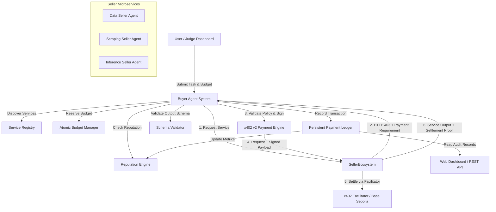
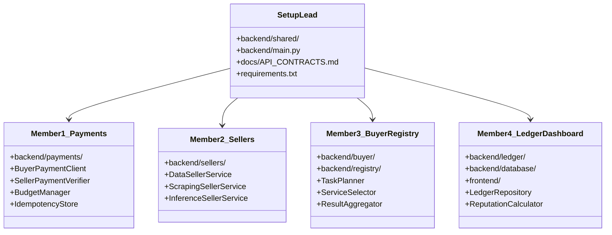
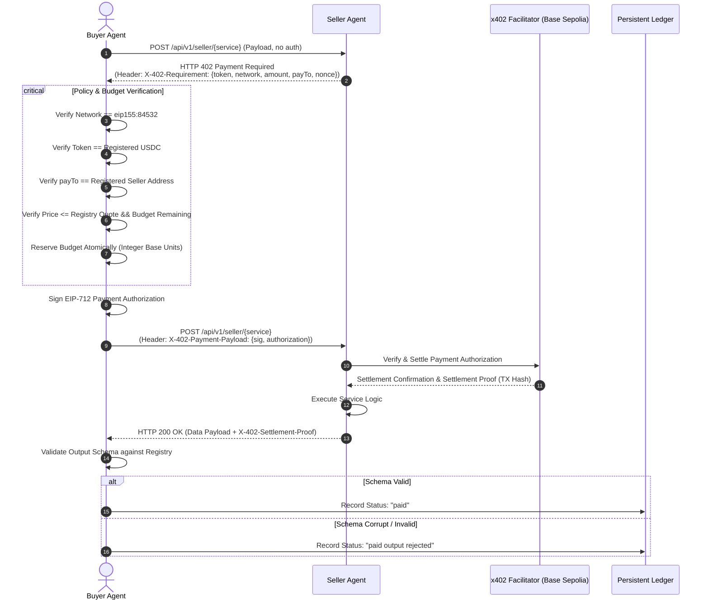
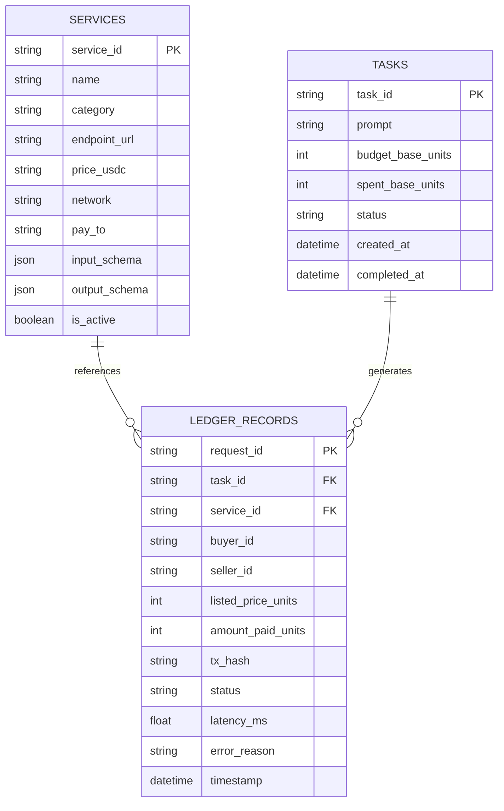

# SYSTEM ARCHITECTURE — PAY-PER-CALL AGENT ECONOMY (DI-06)

## 1. High-Level Architecture Overview

The system implements a decentralized, autonomous pay-per-call microservice economy where software agents interact across HTTP using the **x402 v2 payment standard**.

---

## 2. Component Separation & Ownership

---

## 3. x402 v2 Protocol Lifecycle Sequence

The pay-per-call transaction adheres strictly to the official HTTP 402 payment lifecycle:

---

## 4. Database Schema (Entity-Relationship)

