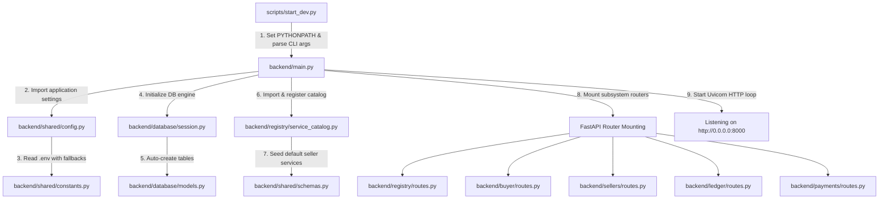
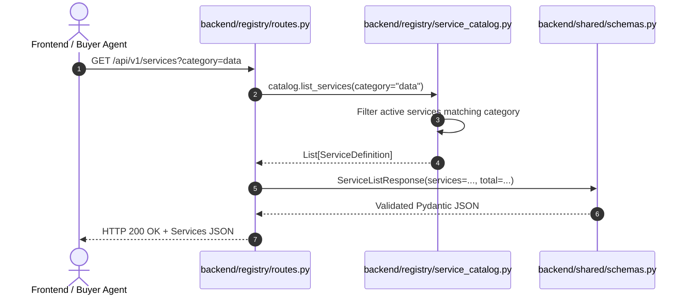
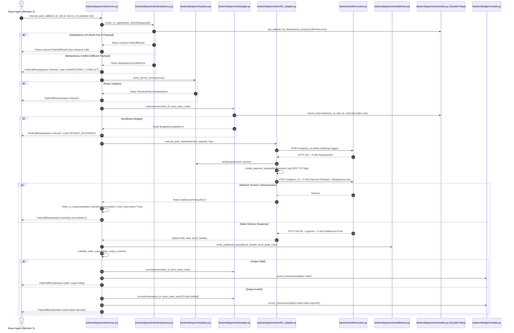
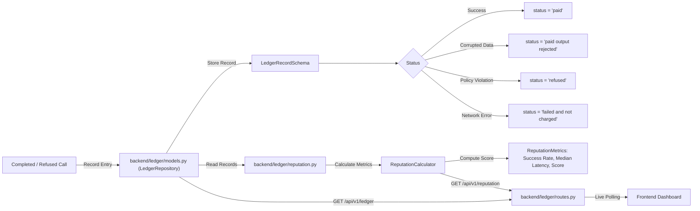

# FLOW.md — COMPLETE EXECUTION LIFECYCLE & CALL SEQUENCES

This document provides a detailed end-to-end execution flow map showing **which file runs, in what order, and how each component interacts** across the entire lifecycle of the Pay-Per-Call Agent Economy.

---

## 1. System Boot & Initialization Flow

When starting the application using `python scripts/start_dev.py` (or `uvicorn backend.main:app`):



### Execution Steps:
1. **Entrypoint:** [`scripts/start_dev.py`](file:///c:/Users/ASUS/Desktop/AgentMarketPlace/scripts/start_dev.py) adds the workspace root to `sys.path` and starts Uvicorn.
2. **Configuration Load:** [`backend/shared/config.py`](file:///c:/Users/ASUS/Desktop/AgentMarketPlace/backend/shared/config.py) reads `.env` variables (Base Sepolia RPC, contract addresses, seller endpoints).
3. **Database Spin-up:** [`backend/database/session.py`](file:///c:/Users/ASUS/Desktop/AgentMarketPlace/backend/database/session.py) sets up the SQLAlchemy engine. The `lifespan` handler in [`backend/main.py`](file:///c:/Users/ASUS/Desktop/AgentMarketPlace/backend/main.py) calls `init_db()` to ensure tables exist in SQLite/PostgreSQL.
4. **Service Catalog Seed:** [`backend/registry/service_catalog.py`](file:///c:/Users/ASUS/Desktop/AgentMarketPlace/backend/registry/service_catalog.py) initializes with default entries for the three sellers (`data_001`, `scraping_001`, `inference_001`).
5. **Route Registration:** All subsystem routers are mounted under `/api/v1/` and health diagnostics under `/health`.

---

## 2. Service Discovery & Registry Flow

When a client or frontend requests `GET /api/v1/services?category=data`:



---

## 3. Member 1 Payment Engine: `execute_paid_call` Flow

When the Buyer Agent (or client) invokes `PaymentService.execute_paid_call()`:



---

## 4. Autonomous Buyer Agent Task Orchestration Flow

When a task is submitted to `POST /api/v1/tasks`:

```mermaid
graph TD
    A["User / Dashboard Submit Task"] -->|POST /api/v1/tasks| B["backend/buyer/routes.py"]
    B -->|submit_and_execute_task()| C["backend/buyer/service.py (BuyerService)"]
    C -->|1. Create DAG Plan| D["backend/buyer/planner.py (TaskPlanner)"]
    D -->|2. Validate Plan & Budget| E["backend/buyer/plan_validator.py (PlanValidator)"]
    E -->|Validation Fails / Over-budget| F["Status: 'refused' (0 funds spent)"]
    E -->|Validation Passes| G["Execute Topological Stages in Parallel"]
    
    G -->|Stage 0: Parallel Calls| H["asyncio.gather bounded by Semaphore(3)"]
    H -->|For each planned step| I["_execute_call()"]
    
    I -->|Step A: Lock Budget| J["backend/payments/budget.py (BudgetManager.reserve_budget)"]
    I -->|Step B: Initial Call| K["POST Seller Endpoint"]
    K -->|HTTP 402 + Requirement| L["PaymentPolicyVerifier.verify()"]
    L -->|Policy Violation| M["Release Budget -> Status: 'refused'"]
    L -->|Policy Valid| N["Member 1 BuyerPaymentClient.create_payment_payload()"]
    
    N -->|Step C: Re-request with Auth| O["POST Seller with X-402-Payment-Payload"]
    O -->|Timeout / Network Drop| P["Status: 'pending_reconciliation' (Hold Budget)"]
    O -->|HTTP 200 without Settlement Proof| P
    O -->|HTTP 200 with Settlement Proof| Q["Member 1 BuyerPaymentClient.verify_settlement()"]
    
    Q -->|Settlement Verified| R["Commit Budget -> Status: 'paid'"]
    R -->|Step D: Validate Output| S["backend/buyer/output_validator.py"]
    S -->|Output Valid| T["Status: 'paid'"]
    S -->|Output Invalid| U["Status: 'paid output rejected'"]
    
    T -->|Step E: Persist to Ledger| V["Member 4 backend/ledger/models.py (ledger_repo)"]
    U -->|Step E: Persist to Ledger| V
    P -->|Step E: Persist to Ledger| V
    M -->|Step E: Persist to Ledger| V
    
    V -->|Step F: Aggregate Provenance| W["backend/buyer/aggregator.py & explanation.py"]
    W -->|Save TaskRecord| X["Member 4 SQL TaskRecordModel"]
```

---

## 5. Ledger Auditing & Provider Reputation Flow

How transaction records transition into audit logs and calculate reputation scores:



---

## 6. Frontend Dashboard Lifecycle Flow

When a user visits `http://localhost:5173`:

1. **Mounting:** [`frontend/src/main.tsx`](file:///c:/Users/ASUS/Desktop/AgentMarketPlace/frontend/src/main.tsx) renders [`frontend/src/App.tsx`](file:///c:/Users/ASUS/Desktop/AgentMarketPlace/frontend/src/App.tsx) which displays [`frontend/src/pages/Dashboard.tsx`](file:///c:/Users/ASUS/Desktop/AgentMarketPlace/frontend/src/pages/Dashboard.tsx).
2. **Polling Loop:** `Dashboard.tsx` establishes a 5-second recurring poll via [`frontend/src/api/client.ts`](file:///c:/Users/ASUS/Desktop/AgentMarketPlace/frontend/src/api/client.ts):
   - `fetchHealth()` -> Updates [`Navbar.tsx`](file:///c:/Users/ASUS/Desktop/AgentMarketPlace/frontend/src/components/Navbar.tsx) with network identifier and health status.
   - `fetchServices()` -> Renders cards in [`ServiceCard.tsx`](file:///c:/Users/ASUS/Desktop/AgentMarketPlace/frontend/src/components/ServiceCard.tsx).
   - `fetchReputations()` -> Displays live reputation scores on service cards.
   - `fetchLedger()` -> Updates [`LedgerTable.tsx`](file:///c:/Users/ASUS/Desktop/AgentMarketPlace/frontend/src/components/LedgerTable.tsx) with formatted badges from [`ReputationBadge.tsx`](file:///c:/Users/ASUS/Desktop/AgentMarketPlace/frontend/src/components/ReputationBadge.tsx).
3. **User Action:** Submitting a prompt triggers `submitBuyerTask()`, which POSTs to `/api/v1/buyer/tasks`, streams the execution status to the UI console, and auto-refreshes the audit log upon completion.

---

## 7. Automated Test Execution Flow

When running `python scripts/run_tests.py`:

```
scripts/run_tests.py
  │
  └── Launches subprocess: pytest backend/tests/ -v
        │
        ├── conftest.py: Instantiates FastAPI TestClient(app)
        │
        ├── test_health.py: Verifies GET /health & OpenAPI JSON
        ├── test_registry.py: Tests catalog listing, schema, and price filtering
        ├── test_payments.py: Tests PaymentPolicyVerifier (network, token, payTo, gouging)
        ├── test_payment_engine.py: Tests Member 1 execute_paid_call(), output schema checks,
        │                          idempotency replays, conflicts, & timeout suspense
        ├── test_budget.py: Tests base unit arithmetic, overdraw blocks, & 10-task concurrency lock
        ├── test_replay.py: Tests nonce single-use cache & idempotency key store
        ├── test_sellers.py: Tests 402 challenge issuance & paid execution stubs
        ├── test_buyer.py: Tests TaskPlanner decomposition & budget refusal
        ├── test_buyer_task_api.py: Tests /api/v1/tasks endpoints, lifecycle states, and polling
        ├── test_planner_validator.py: Tests DAG validation, cycle detection, and price tampering
        ├── test_buyer_orchestration_payment.py: Tests payment routing, budget lock, and pending reconciliation
        ├── test_buyer_dependency_execution.py: Tests sequential deps, parallel execution, timeouts, & fallbacks
        ├── test_output_validation_provenance.py: Tests Draft-7 schema rejections, paid_output_rejected accounting, safe fallbacks, zero fact hallucination, and field-level provenance
        ├── test_purchase_explanation.py: Tests authoritative ledger totals, missing ledger data, pending reconciliation isolation, non-fabricated explorer links, and spending summaries
        ├── test_member3.py: Tests canonical /api/v1/tasks lifecycle, query filters, output validation, & reputation
        ├── test_ledger.py: Tests LedgerStatus enum values & reputation computation math
        └── test_integration.py: Executes end-to-end multi-step workflow harness
```

All automated test suites verify every subsystem interface before developer feature branches are merged, executing with a 100% pass rate across all subsystems.
