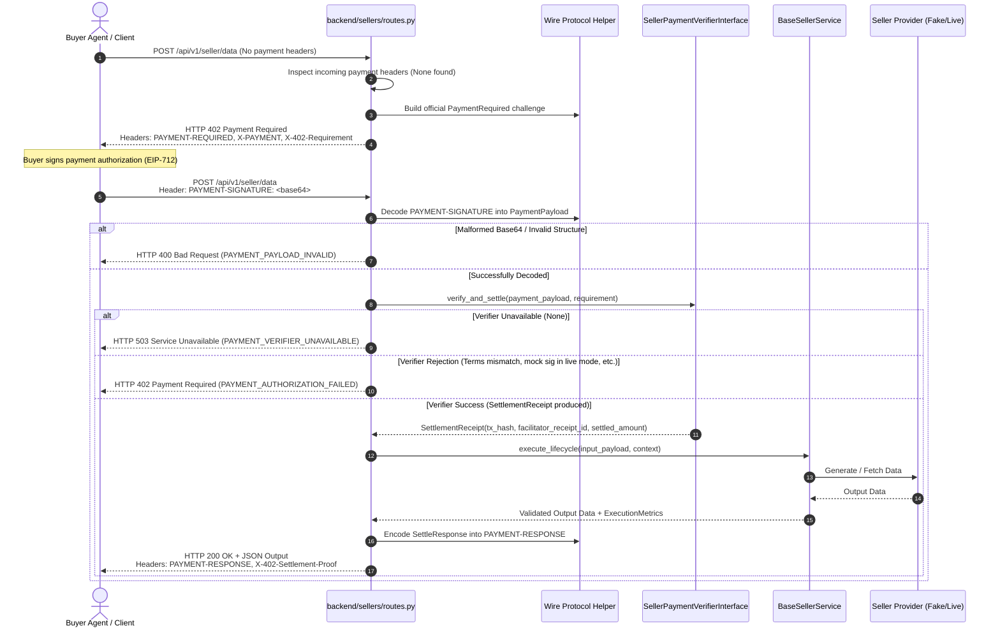

# M2 Phase 2.5 — Official x402 Seller Protocol Contract

**Subsystem:** Member 2 — Seller Agents  
**Author:** Member 2 Technical Lead  
**Document:** Seller-Side x402 Integration Contract  
**Target:** Phase 2.5 Official Protocol Compliance Gate  
**Date:** 2026-10-17  
**Branch:** `M2`  

---

## 1. Scope & Purpose

This specification defines the authoritative protocol contract for all three Seller microservices:
1. **Data Seller** (`POST /api/v1/seller/data`)
2. **Scraping Seller** (`POST /api/v1/seller/scraping`)
3. **Inference Seller** (`POST /api/v1/seller/inference`)

The contract aligns seller endpoints with the official `x402==2.25.0` v2 specification while maintaining backward compatibility with application-level headers.

---

## 2. Protocol Header Specifications

### 2.1 Challenge Headers (HTTP 402)
When an incoming request does not provide a valid payment authorization, the seller responds with `HTTP 402 Payment Required` and emits:

| Header Name | Type | Value Specification |
| :--- | :--- | :--- |
| **`PAYMENT-REQUIRED`** | Official Primary | Base64-encoded `PaymentRequired` object (`x402_http.encode_payment_required_header`) |
| **`X-PAYMENT`** | Official Alias | Identical Base64-encoded `PaymentRequired` object |
| **`X-402-Requirement`** | App Legacy | JSON-encoded `PaymentRequirement` dictionary |
| **`Access-Control-Expose-Headers`** | CORS | `PAYMENT-REQUIRED, PAYMENT-RESPONSE, X-PAYMENT, X-PAYMENT-RESPONSE, X-402-Requirement, X-402-Settlement-Proof` |

#### Challenge Schema Structure:
- `x402_version`: `2`
- `accepts`: Array of 1 requirement:
  - `scheme`: `"exact"`
  - `network`: `"eip155:84532"` (Base Sepolia)
  - `asset`: `"0x036CbD53842c5426634e7929541eC2318f3dCF7e"` (USDC Base Sepolia)
  - `amount`: Base units string (`"2000"`, `"3000"`, or `"4000"`)
  - `pay_to`: Registered seller recipient address
  - `max_timeout_seconds`: `15` or `60`
  - `extra`: `{"nonce": "<server_issued_nonce>", "service_id": "<service_id>"}`

---

### 2.2 Payment Authorization Headers (Request)
When a buyer retries a paid call, the seller inspects the request headers in priority order:

1. **`PAYMENT-SIGNATURE`** (Official primary): Base64-encoded `PaymentPayload` wire string.
2. **`X-PAYMENT`** (Official alias): Base64-encoded `PaymentPayload` wire string.
3. **`X-402-Payment-Payload`** (Legacy application): Raw JSON string matching `PaymentPayload` schema.

#### Extraction Rules:
- If `PAYMENT-SIGNATURE` or `X-PAYMENT` is present, it is decoded via `x402_http.decode_payment_signature_header`.
  - `authorization` is extracted from `pl.payload["authorization"]`.
  - `signature` is extracted from `pl.payload["signature"]` or `pl.extensions["signature"]`.
  - `buyer_address` is extracted from `authorization.get("buyer_address")` or recovered.
- If only `X-402-Payment-Payload` is present, it is parsed via `PaymentPayload.model_validate_json(raw_str)`.
- If both headers are absent, whitespace-only, or empty, the seller treats payment as missing and issues an HTTP 402 challenge.
- If header is present but malformed (invalid base64 or unparseable JSON), the seller fails closed with `HTTP 400 Bad Request` and `PAYMENT_PAYLOAD_INVALID`.

---

### 2.3 Settlement Proof Headers (HTTP 200)
When payment verification succeeds and seller execution delivers a valid payload conforming to schema, the seller returns `HTTP 200 OK` with:

| Header Name | Type | Value Specification |
| :--- | :--- | :--- |
| **`PAYMENT-RESPONSE`** | Official Primary | Base64-encoded `SettleResponse` object (`x402_http.encode_payment_response_header`) |
| **`X-PAYMENT-RESPONSE`** | Official Alias | Identical Base64-encoded `SettleResponse` object |
| **`X-402-Settlement-Proof`** | App Legacy | Verbatim settlement receipt ID or on-chain transaction hash string |

#### SettleResponse Schema Structure:
- `success`: `True`
- `transaction`: `<tx_hash_or_receipt_id>`
- `network`: `"eip155:84532"`
- `amount`: Base units string (e.g. `"2000"`)
- `payer`: `<buyer_wallet_address>`

---

## 3. End-to-End Lifecycle Sequence

---

## 4. Fail-Closed Error Matrix

| Condition | HTTP Status | Error Code | Response Headers | Business Logic Executed? |
| :--- | :---: | :--- | :--- | :---: |
| Missing payment headers | `402` | N/A (Standard challenge) | `PAYMENT-REQUIRED`, `X-402-Requirement` | **NO** |
| Empty or whitespace payment header | `402` | N/A (Standard challenge) | `PAYMENT-REQUIRED`, `X-402-Requirement` | **NO** |
| Malformed base64 / invalid JSON | `400` | `PAYMENT_PAYLOAD_INVALID` | None | **NO** |
| Verifier not configured (`None`) | `503` | `PAYMENT_VERIFIER_UNAVAILABLE` | None | **NO** |
| Verifier raises domain exception | `402` | `PAYMENT_AUTHORIZATION_FAILED` | None | **NO** |
| Verifier returns `None` receipt | `402` | `PAYMENT_AUTHORIZATION_FAILED` | None | **NO** |
| Verifier returns empty proof | `402` | `PAYMENT_AUTHORIZATION_FAILED` | None | **NO** |
| Seller input validation fails | `422` | `SELLER_INPUT_VALIDATION_ERROR` | None | **NO** |
| Seller execution times out | `504` | `SELLER_EXECUTION_TIMEOUT` | None | Partially (Aborted) |
| Seller output fails validation | `502` | `SELLER_OUTPUT_VALIDATION_ERROR` | None | Yes (Output Slashing) |
| Seller internal crash | `500` | `SELLER_EXECUTION_ERROR` | None | Yes (Sanitized) |

---

## 5. Security & Safety Invariants

1. **Zero Execution Before Settlement:** Seller business logic coroutine is NEVER scheduled or executed prior to receiving a confirmed, non-empty `SettlementReceipt` from `SellerPaymentVerifierInterface`.
2. **Zero Proof on Non-200:** Settlement proof headers (`PAYMENT-RESPONSE`, `X-402-Settlement-Proof`) are attached STRICTLY to HTTP 200 responses. Error responses (4xx, 5xx) NEVER attach settlement proof.
3. **No Synthetic Proofs:** Sellers NEVER fabricate fake proofs (`receipt_<uuid>` or random hashes). Only the authentic proof returned by the verifier is passed.
4. **Preserved SSRF & Provider Protections:** Scraping URL sanitization, bounded output lengths, IP pinning, DNS rebinding defenses, and concurrency bounds remain intact.
