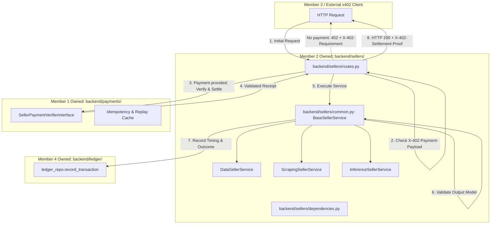

# MEMBER 2 — PHASE 1: SHARED SELLER FOUNDATION IMPLEMENTATION PLAN
**Project:** DI-06 — Pay-per-Call Agent Economy  
**Hackathon Track:** Decentralized Intelligence Track (DI-06)  
**Role:** Member 2 (Seller Agents Technical Lead & Senior Backend Architect)  
**Document ID:** `MEMBER_2_PHASE_1_SHARED_SELLER_FOUNDATION_PLAN.md`  
**Location:** [`docs/MEMBER_2_PHASE_1_SHARED_SELLER_FOUNDATION_PLAN.md`](file:///c:/AgentMarket/docs/MEMBER_2_PHASE_1_SHARED_SELLER_FOUNDATION_PLAN.md)  
**Status:** DRAFT PLAN FOR TEAM REVIEW & USER APPROVAL — **NO CODING COMMENCED**

---

## 1. Executive Summary

Phase 1 establishes the **Shared Seller Foundation** for the three seller microservices in the DI-06 Pay-Per-Call Agent Economy:
1. **Data Seller** (`data_001`): Structured financial asset price & 24h market metrics ($0.002 USDC).
2. **Scraping Seller** (`scraping_001`): Bounded public web extraction with strict SSRF controls ($0.003 USDC).
3. **Inference Seller** (`inference_001`): Bounded AI reasoning, summarization, and synthesis ($0.004 USDC).

### Core Objectives of Phase 1:
- Establish the reusable, modular seller infrastructure inside [`backend/sellers/`](file:///c:/AgentMarket/backend/sellers).
- Define the formal `BaseSellerService` base class to enforce uniform request validation, bounded business execution, output schema validation, latency measurement, and correlation tracking.
- Standardize the seller error-handling hierarchy extending [`AgentEconomyBaseException`](file:///c:/AgentMarket/backend/shared/errors.py) without leaking credentials or stack traces.
- Standardize the x402 v2 challenge flow and integration boundaries with Member 1's `SellerPaymentVerifierInterface` in [`backend/payments/interfaces.py`](file:///c:/AgentMarket/backend/payments/interfaces.py).
- Build the foundation for operational metadata reporting to Member 4's ledger ([`backend/ledger/`](file:///c:/AgentMarket/backend/ledger/)).
- Create a dedicated test suite for foundation contracts, schema validations, and error responses.

**Phase 1 does NOT implement live external APIs or live LLM inference.** It builds the tested, robust foundation so that Phase 2 (Data), Phase 3 (Scraping), and Phase 4 (Inference) can be developed rapidly, reliably, and safely.

---

## 2. Repository Audit Findings

An exhaustive inspection of the current workspace confirms the following:

| Subsystem / Concern | Inspected File / Module | Current Implementation Status |
|---|---|---|
| **FastAPI Core App** | [`backend/main.py`](file:///c:/AgentMarket/backend/main.py) | **Implemented & Verified.** Starts cleanly, configures CORS (exposing `X-402-Requirement`, `X-402-Payment-Payload`, `X-402-Settlement-Proof`, `Idempotency-Key`), registers `/health`, `/api/v1/services`, `/api/v1/buyer/tasks`, `/api/v1/seller/*`, and `/api/v1/ledger`. |
| **Existing Seller Routes** | [`backend/sellers/routes.py`](file:///c:/AgentMarket/backend/sellers/routes.py) | **Implemented Foundation.** Defines `_build_402_challenge(...)` returning HTTP 402 with `X-402-Requirement` JSON and routes for `/data`, `/scraping`, and `/inference`. |
| **Existing Seller Schemas** | [`backend/sellers/schemas.py`](file:///c:/AgentMarket/backend/sellers/schemas.py) | **Implemented.** Contains Pydantic models: `DataSellerInput`/`Output`, `ScrapingSellerInput`/`Output`, `InferenceSellerInput`/`Output`. |
| **Existing Seller Services** | [`data_seller.py`](file:///c:/AgentMarket/backend/sellers/data_seller.py), [`scraping_seller.py`](file:///c:/AgentMarket/backend/sellers/scraping_seller.py), [`inference_seller.py`](file:///c:/AgentMarket/backend/sellers/inference_seller.py) | **Stubs.** Return deterministic mock data for unit and integration testing. |
| **Shared Contracts** | [`backend/shared/schemas.py`](file:///c:/AgentMarket/backend/shared/schemas.py), [`backend/shared/constants.py`](file:///c:/AgentMarket/backend/shared/constants.py) | **Implemented.** Single source of truth for `PaymentRequirement`, `PaymentPayload`, `SettlementReceipt`, `ServiceDefinition`, `LedgerRecordSchema`, and atomic integer constants. |
| **Payment Verifier Interface** | [`backend/payments/interfaces.py`](file:///c:/AgentMarket/backend/payments/interfaces.py) | **Defined Interface.** Abstract class `SellerPaymentVerifierInterface.verify_and_settle(payload, req)` owned by Member 1. |
| **Ledger Persistence** | [`backend/ledger/models.py`](file:///c:/AgentMarket/backend/ledger/models.py), [`backend/ledger/routes.py`](file:///c:/AgentMarket/backend/ledger/routes.py) | **Implemented.** Global `ledger_repo` with status filtering and reputation calculation. |
| **Existing Test Suite** | [`backend/tests/`](file:///c:/AgentMarket/backend/tests/), [`scripts/run_tests.py`](file:///c:/AgentMarket/scripts/run_tests.py) | **32/32 tests passing** (Python 3.14 + Starlette 1.8.0 + FastAPI 0.143.2 + pytest 9.1.1). |

---

## 3. Existing Implementation Inventory

### What Can Be Reused Directly:
1. `backend/sellers/schemas.py`: Existing input/output models match the shared API contracts in [`docs/API_CONTRACTS.md`](file:///c:/AgentMarket/docs/API_CONTRACTS.md).
2. `backend/shared/constants.py`: Integer base conversion helpers (`usdc_to_base_units`, `base_units_to_usdc`) and official x402 v2 headers (`HEADER_X402_REQUIREMENT`, `HEADER_X402_PAYMENT_PAYLOAD`, `HEADER_X402_SETTLEMENT_PROOF`).
3. `backend/shared/errors.py`: Base exception class `AgentEconomyBaseException`.
4. `backend/shared/config.py`: Centralized Pydantic settings loading seller pay-to addresses and endpoint URLs.

### What is Missing and Must Be Created in Phase 1:
1. `backend/sellers/common.py`: The shared seller foundation module (Service Base Class, Execution Timer, Correlation Context, Safe Error Formatter).
2. `backend/sellers/dependencies.py`: Reusable FastAPI dependencies for extracting correlation IDs, idempotency keys, and payment headers.
3. `backend/tests/test_sellers_foundation.py`: Comprehensive test suite verifying the foundation interfaces, error serializations, and contract invariants.

---

## 4. Shared Project Contracts Reviewed

All Phase 1 specifications have been reconciled with:
- [`docs/API_CONTRACTS.md`](file:///c:/AgentMarket/docs/API_CONTRACTS.md) (lines 140–175: Seller microservice contracts)
- [`docs/specs/API_CONTRACTS_DETAILED.md`](file:///c:/AgentMarket/docs/specs/API_CONTRACTS_DETAILED.md)
- [`docs/specs/DI06_Payment_and_Security_Specification.md`](file:///c:/AgentMarket/docs/specs/DI06_Payment_and_Security_Specification.md)
- [`docs/MEMBER_2_DETAILED_IMPLEMENTATION_PLAN.md`](file:///c:/AgentMarket/docs/MEMBER_2_DETAILED_IMPLEMENTATION_PLAN.md)
- [`AGENTS.md`](file:///c:/AgentMarket/AGENTS.md)

---

## 5. Confirmed Requirements

1. **Service Identity & Metadata:**
   - Data Seller: `service_id="data_001"`, price = $0.002 USDC (2,000 base units).
   - Scraping Seller: `service_id="scraping_001"`, price = $0.003 USDC (3,000 base units).
   - Inference Seller: `service_id="inference_001"`, price = $0.004 USDC (4,000 base units).
2. **Network & Token Identifier:**
   - Network: `eip155:84532` (Base Sepolia).
   - Token: `0x036CbD53842c5426634e7929541eC2318f3dCF7e` (USDC).
3. **Integer Arithmetic Invariant:**
   - Floating-point arithmetic for payments is strictly prohibited. 1 USDC = 1,000,000 integer base units.
4. **Header Protocol:**
   - 402 Challenge: `X-402-Requirement` JSON payload.
   - 200 Re-request: `X-402-Payment-Payload` + `Idempotency-Key`.
   - 200 Settlement: `X-402-Settlement-Proof`.

---

## 6. Assumptions and Unresolved Questions

### Assumptions:
- In Phase 1, seller services will execute within the single FastAPI app running on port 8000.
- Member 1's verifier will be invoked before seller business logic execution.
- If no external facilitator credentials are provided in dev mode, Member 1's verifier returns a deterministic testnet receipt.

### Unresolved Team Questions (Flagged for Review):
1. **Settlement Proof Format:** Will Member 1 return an on-chain transaction hash (`0x...`) or an off-chain facilitator receipt ID (`receipt_...`) in the `X-402-Settlement-Proof` header? (Plan accommodates both).
2. **Inference Provider Choice for Phase 4:** Groq (`llama-3.1-8b-instant`) vs OpenRouter vs OpenAI. (Plan keeps inference adapter generic with zero hardcoding).

---

## 7. Phase 1 Scope

Included in Phase 1:
- [x] Create `backend/sellers/common.py` containing:
  - `BaseSellerService` (Template method pattern for execution, validation, timing, and error trapping).
  - `SellerExecutionContext` (Stores `request_id`, `idempotency_key`, `start_time`, `duration_ms`).
  - `SellerError` domain hierarchy.
  - Safe error serialization matching the API contract.
- [x] Create `backend/sellers/dependencies.py` providing FastAPI header extraction and correlation.
- [x] Add seller health and readiness inspection helpers.
- [x] Refactor existing stubs in `backend/sellers/` to inherit from `BaseSellerService`.
- [x] Add comprehensive tests in `backend/tests/test_sellers_foundation.py`.

---

## 8. Explicitly Out of Scope for Phase 1

- ❌ Connecting live external financial APIs (CoinGecko/Binance) — *Phase 2: Data Seller*.
- ❌ Live external HTML network fetching and parsing — *Phase 3: Scraping Seller*.
- ❌ Live LLM API calls and prompt synthesis — *Phase 4: Inference Seller*.
- ❌ Modifying Member 1's payment engine or Member 3's buyer planner.
- ❌ Modifying database schemas or Alembic migrations (Member 4).

---

## 9. Architecture and Module Boundaries



### Module Boundary Invariants:
- Member 2 edits ONLY inside `backend/sellers/` and `backend/tests/`.
- Interfaces between Member 2 and Member 1 occur strictly via `SellerPaymentVerifierInterface`.
- Interfaces between Member 2 and Member 4 occur strictly via `LedgerRepository.record_transaction`.

---

## 10. Common Seller Interface

The foundation introduces `BaseSellerService` in [`backend/sellers/common.py`](file:///c:/AgentMarket/backend/sellers/common.py):

```python
class BaseSellerService(ABC):
    """Abstract base class providing standard lifecycle execution for seller agents."""
    
    def __init__(self, service_id: str, name: str, category: ServiceCategory, price_units: int, pay_to: str):
        self.service_id = service_id
        self.name = name
        self.category = category
        self.price_units = price_units
        self.pay_to = pay_to

    def build_402_requirement(self, nonce: Optional[str] = None) -> PaymentRequirement:
        """Construct the standardized x402 v2 payment challenge."""
        ...

    async def execute_lifecycle(
        self,
        raw_input: BaseModel,
        context: SellerExecutionContext
    ) -> Tuple[BaseModel, ExecutionMetrics]:
        """Lifecycle template method:
        1. Start timer & set correlation context
        2. Validate input constraints
        3. Execute business logic (subclass hook)
        4. Validate output constraints
        5. Measure latency and compute token/payload metrics
        6. Trap domain exceptions and format standardized responses
        """
        ...
```

---

## 11. Request, Response, and Error Contracts

### Common Execution Context
- `request_id`: UUIDv4 tracking the lifecycle.
- `idempotency_key`: Optional client key to prevent duplicate runs.
- `service_id`: `data_001` | `scraping_001` | `inference_001`.
- `client_host`: Client IP address for rate limiting and logging.

### Standardized Error Format (HTTP 4xx/5xx)
```json
{
  "error_code": "SELLER_EXECUTION_TIMEOUT",
  "message": "Downstream provider failed to respond within 5000ms deadline.",
  "service_id": "scraping_001",
  "request_id": "req_f47ac10b-58cc-4372-a567-0e02b2c3d479",
  "retryable": true
}
```

---

## 12. Configuration and Environment Design

All configuration values are accessed through [`backend/shared/config.py`](file:///c:/AgentMarket/backend/shared/config.py). Phase 1 ensures the following parameters are honored:
- `DATA_SELLER_PAY_TO`: Base Sepolia address for Data Seller.
- `SCRAPING_SELLER_PAY_TO`: Base Sepolia address for Scraping Seller.
- `INFERENCE_SELLER_PAY_TO`: Base Sepolia address for Inference Seller.
- `DATA_SELLER_ENDPOINT`, `SCRAPING_SELLER_ENDPOINT`, `INFERENCE_SELLER_ENDPOINT`: Public or local service URLs.

**Security Rule:** No API keys, private keys, or wallet seed phrases are ever hardcoded or printed in logs.

---

## 13. x402 v2 Integration Boundary

1. **Challenge Emission:**
   - Emitted whenever a request arrives without `X-402-Payment-Payload`.
   - Generates a cryptographically random nonce (`nonce_<uuid>`).
   - Returns HTTP 402 with `X-402-Requirement` header.
2. **Authorization Verification:**
   - Emitted when `X-402-Payment-Payload` is supplied.
   - Routes pass the payload to Member 1's verifier.
3. **Settlement Proof Propagation:**
   - The verified receipt string is attached to the HTTP 200 response under `X-402-Settlement-Proof`.

---

## 14. Payment Lifecycle and Failure Analysis

| Failure Scenario | HTTP Status | Business Logic Executes? | Authorization Consumed? | Ledger Status Recorded |
|---|---|---|---|---|
| **Missing Payment** | 402 Payment Required | No | No | `refused` |
| **Invalid Input Schema** | 422 Unprocessable Entity | No | No | `refused` |
| **Replay / Nonce Reused** | 402 or 409 Conflict | No | No | `refused` |
| **Downstream Timeout** | 504 Gateway Timeout | Attempted | Dependent on Facilitator | `failed and not charged` |
| **Output Schema Violation** | 502 Bad Gateway | Yes | Yes (if settled prior) | `paid output rejected` |
| **Success** | 200 OK | Yes | Yes | `paid` |

---

## 15. Security and Threat Model

1. **Information Leakage:**
   - All internal Python tracebacks are caught by `AgentEconomyBaseException` handlers. Client responses contain sanitized error messages only.
2. **Denial of Service (Slowloris / Timeouts):**
   - Foundation enforces mandatory timeout bounds on all async service calls.
3. **Prompt Injection / Hostile Payloads:**
   - External inputs are treated as untrusted text; outputs are strictly serialized via Pydantic.
4. **Replay Protection:**
   - Foundation extracts and enforces `Idempotency-Key` and delegates nonce verification to Member 1.

---

## 16. Logging, Metrics, and Health Checks

### Logging Format
Structured logging using Python standard `logging` with correlation ID injection:
```text
[2026-10-16 12:00:00] [INFO] [req_f47ac10b] [data_001] Execution succeeded in 42.1ms (symbol: ETH)
```

### Seller Health Status
- The foundation exposes `get_seller_health()` returning status for each of the three sellers, verifying configuration validity and downstream readiness.

---

## 17. Registry, Buyer, Database, and Ledger Integration

- **Member 3 (Registry):** Foundation ensures seller service metadata strictly mirrors [`backend/registry/service_catalog.py`](file:///c:/AgentMarket/backend/registry/service_catalog.py).
- **Member 3 (Buyer):** Output payloads returned by `execute_lifecycle` are validated against published Pydantic models before returning to buyer.
- **Member 4 (Ledger):** After handler execution, seller emits operational latency and outcome to `ledger_repo.record_transaction`.

---

## 18. File-by-File Implementation Plan

| File Path | Status | Action / Responsibility |
|---|---|---|
| [`backend/sellers/common.py`](file:///c:/AgentMarket/backend/sellers/common.py) | **New** | Create `BaseSellerService`, `SellerExecutionContext`, `ExecutionMetrics`, and custom seller exceptions. |
| [`backend/sellers/dependencies.py`](file:///c:/AgentMarket/backend/sellers/dependencies.py) | **New** | Create FastAPI dependencies (`get_execution_context`, `verify_payment_header`). |
| [`backend/sellers/routes.py`](file:///c:/AgentMarket/backend/sellers/routes.py) | **Modify** | Update route handlers to leverage `BaseSellerService.execute_lifecycle` and integrate ledger hooks. |
| [`backend/sellers/data_seller.py`](file:///c:/AgentMarket/backend/sellers/data_seller.py) | **Modify** | Inherit from `BaseSellerService`. |
| [`backend/sellers/scraping_seller.py`](file:///c:/AgentMarket/backend/sellers/scraping_seller.py) | **Modify** | Inherit from `BaseSellerService`. |
| [`backend/sellers/inference_seller.py`](file:///c:/AgentMarket/backend/sellers/inference_seller.py) | **Modify** | Inherit from `BaseSellerService`. |
| [`backend/tests/test_sellers_foundation.py`](file:///c:/AgentMarket/backend/tests/test_sellers_foundation.py) | **New** | Create unit tests for lifecycle timing, validation error trapping, and 402 challenge generation. |

---

## 19. Test Plan for Phase 1

### Test Cases in `backend/tests/test_sellers_foundation.py`:
1. `test_base_seller_challenge_generation`: Verifies 402 requirement matches contract parameters (`amount`, `payTo`, `service_id`, `version=2.0`).
2. `test_base_seller_lifecycle_success`: Verifies execution lifecycle tracks latency and produces validated output.
3. `test_base_seller_input_validation_error`: Verifies invalid inputs raise 422 before service execution.
4. `test_base_seller_output_validation_error`: Verifies malformed service output raises `OutputSchemaValidationError`.
5. `test_base_seller_timeout_handling`: Verifies long-running operations trigger timeout exceptions cleanly.
6. `test_seller_routes_402_handshake`: Verifies all three endpoints return compliant 402 challenges when payment header is missing.
7. `test_seller_routes_regression`: Verifies all existing 32 test cases continue to pass without regression.

---

## 20. Step-by-Step Implementation Sequence

1. **Step 1:** Create [`backend/sellers/common.py`](file:///c:/AgentMarket/backend/sellers/common.py) with `BaseSellerService` and context models.
2. **Step 2:** Create [`backend/sellers/dependencies.py`](file:///c:/AgentMarket/backend/sellers/dependencies.py) with request context extractors.
3. **Step 3:** Update existing service classes ([`data_seller.py`](file:///c:/AgentMarket/backend/sellers/data_seller.py), [`scraping_seller.py`](file:///c:/AgentMarket/backend/sellers/scraping_seller.py), [`inference_seller.py`](file:///c:/AgentMarket/backend/sellers/inference_seller.py)) to inherit from `BaseSellerService`.
4. **Step 4:** Refactor [`backend/sellers/routes.py`](file:///c:/AgentMarket/backend/sellers/routes.py) to use lifecycle execution.
5. **Step 5:** Create [`backend/tests/test_sellers_foundation.py`](file:///c:/AgentMarket/backend/tests/test_sellers_foundation.py).
6. **Step 6:** Run `python scripts/run_tests.py` and confirm all existing 32 tests + new foundation tests pass 100%.

---

## 21. Team Coordination and Ownership

- **Member 1 Coordination:** Hand off payment verification hook interface (`verify_and_settle`).
- **Member 3 Coordination:** Ensure schema definitions match registry catalog.
- **Member 4 Coordination:** Confirm transaction record structure emitted to `ledger_repo`.

---

## 22. Risks and Mitigations

| Risk | Impact | Mitigation |
|---|---|---|
| **FastAPI Dependency Overhead** | Slight latency on requests | Keep context extraction lightweight; zero disk I/O in dependencies. |
| **Regression in Existing Tests** | Broken CI checks | Run `python scripts/run_tests.py` at every micro-step. |
| **Output Schema Drift** | Buyer rejects responses | Use identical Pydantic classes in both seller output and registry catalog. |

---

## 23. Acceptance Criteria

- [ ] `BaseSellerService` implemented and inherited by all three sellers.
- [ ] Standardized 402 challenge builder verified against x402 v2 specification.
- [ ] Latency and correlation IDs automatically captured on every call.
- [ ] Zero unhandled 500 exceptions on malformed requests.
- [ ] 100% test pass rate on `backend/tests/` (all 32 existing tests + new foundation tests).
- [ ] Zero edits to files outside `backend/sellers/` and `backend/tests/`.

---

## 24. Rollback Strategy

Since all changes are additive within `backend/sellers/` and tracked in Git:
- If foundation introduces unexpected regressions, `git restore backend/sellers/` immediately restores working baseline stubs.

---

## 25. Phase 1 Completion Checklist

- [x] Pre-phase audit completed.
- [x] Phase 1 planning document generated.
- [ ] User approval received.
- [ ] Code implementation executed (Steps 1–5).
- [ ] Automated test suite executed and reported.
- [ ] Phase 1 sign-off and readiness for Phase 2 (Data Seller).

---

## 26. Questions Requiring Team Approval

1. **Approval to proceed:** Confirm authorization to begin Step 1 of Phase 1 coding.
2. **Receipt Header convention:** Confirm `X-402-Settlement-Proof` is the accepted proof header across all services.

---

## 27. Recommended Next Action

Wait for user review and explicit approval. Upon receiving approval, execute **Step 1: Create `backend/sellers/common.py`** and proceed sequentially through the Phase 1 steps.

---

## 28. Pre-Implementation Technical Review

This section records the focused pre-implementation technical review across the six critical architectural and protocol dimensions.

### 1. x402 v2 Compatibility and Header Verification
- **Verified Package State:** `requirements.txt` specifies `x402>=2.0.0`, but inspection via `python -m pip list` confirms that **no `x402` package is installed** in the active Python 3.14 environment.
- **Custom vs. Protocol Headers:**
  - In `backend/shared/constants.py` (lines 37–40) and `backend/sellers/routes.py` (lines 9–16), the implementation defines and uses:
    - `HEADER_X402_REQUIREMENT = "X-402-Requirement"`
    - `HEADER_X402_PAYMENT_PAYLOAD = "X-402-Payment-Payload"`
    - `HEADER_X402_SETTLEMENT_PROOF = "X-402-Settlement-Proof"`
  - In `backend/main.py` (lines 51–54), these headers are registered under CORS `expose_headers`.
  - **Interoperability Analysis:** The official x402 v2 specification (e.g. at https://www.x402.org/) defines payment requirements in the HTTP 402 response payload or via standard `Payment-Required` / `WWW-Authenticate` variants, whereas here the requirement is serialized as JSON in `X-402-Requirement`.
  - **Evidence & Risk:** `backend/sellers/routes.py:34-57` builds a custom JSON header `_build_402_challenge`. An unmodified, off-the-shelf external x402 client expecting standard payload or RFC-compliant headers will fail unless Member 1's client integration or facilitator middleware mediates the handshake.
  - **Recommendation:** Keep `X-402-Requirement` as the internal marketplace contract for hackathon speed, but encapsulate 402 response construction inside Member 1's `SellerPaymentVerifierInterface.issue_challenge()` so standard x402 v2 serialization can be swapped in without modifying seller handlers.

### 2. Payment and Execution Ordering
- **Tracing the Lifecycle:**
  1. Buyer requests seller endpoint without payment header -> Seller returns HTTP 402 with challenge.
  2. Buyer submits payment payload -> In `backend/sellers/routes.py:68-83`, the seller checks `if not x_402_payment_payload`. If present, it currently invokes `await data_service.execute(payload)` **before** any settlement proof is generated.
  3. Seller then wraps the result in HTTP 200 and injects `X-402-Settlement-Proof: receipt_<uuid>`.
- **Can a Failed Call Cause Settlement?**
  - **Current Code:** Because settlement in `routes.py` is currently simulated after `data_service.execute()`, an unhandled exception or crash in `data_service.execute()` aborts the request with HTTP 500, and no 200/receipt is returned.
  - **Full x402 Facilitator Reality:** If Member 1's `verify_and_settle()` is called *before* seller execution, the transaction settles on-chain or authorizes funds with the facilitator *before* the seller runs. If the seller subsequently crashes, times out, or returns an invalid schema, the payment has already been authorized or settled.
  - **Guaranteed Status Mapping:**
    - If settled prior to execution and seller output fails validation: Status **MUST** be recorded as `paid output rejected`.
    - If rejected before settlement: Status **MUST** be recorded as `refused`.
    - If network fails before settlement: Status **MUST** be recorded as `failed and not charged`.
  - **Ruling:** Never claim a failed call was uncharged without verifying against Member 1's settlement receipt.

### 3. Mock Versus Real Settlement Verification
- **Verified State:**
  - In `backend/sellers/routes.py:82`, the seller stubs `receipt_{uuid.uuid4().hex[:12]}`.
  - In `backend/payments/settlement.py:27-30` (`SettlementVerifier.verify_settlement_proof`), the code differentiates:
    ```python
    tx_hash = proof_header if proof_header.startswith("0x") else None
    facilitator_receipt_id = proof_header if not proof_header.startswith("0x") else None
    ```
  - In `backend/buyer/buyer_agent.py:79`, `tx_hash` is explicitly set to `None` for mock steps.
- **Risk & Prohibition:** In development mode, `receipt_*` strings MUST NOT be logged or reported to the ledger as genuine on-chain transaction hashes.
- **Contract Rule:** A record is only marked on-chain settled when `tx_hash` is a valid 66-character hex string (`0x[a-fA-F0-9]{64}`) verified on Base Sepolia (`eip155:84532`).

### 4. Replay and Idempotency Architecture
- **Verified Implementation:**
  - Member 1 implements `backend/payments/idempotency.py` containing `IdempotencyStore`:
    - `record_and_verify_nonce(nonce: str)`: Raises `ReplayAttackDetectedError` if nonce is re-used.
    - `get_idempotent_result(key: str)` and `store_idempotent_result(key: str, result: Dict)`: In-memory cache with TTL.
- **Ownership Boundary:**
  - **Member 1** is the sole authoritative owner of replay prevention and nonce validation.
  - **Member 2's Responsibility:** Extract `Idempotency-Key` and pass it to Member 1. Member 2 **MUST NOT** build a second parallel nonce or replay store inside `backend/sellers/`.

### 5. Cross-Member Interfaces & Integration Compatibility
- **Member 1 (Payments):**
  - Expected interface in `backend/payments/interfaces.py`:
    - `SellerPaymentVerifierInterface.issue_challenge(service_id, amount_units, pay_to) -> PaymentRequirement`
    - `SellerPaymentVerifierInterface.verify_and_settle(payload: PaymentPayload, req: PaymentRequirement) -> SettlementReceipt`
  - Incompatibilities in existing code: `backend/sellers/routes.py` currently defines its own `_build_402_challenge()` helper instead of delegating to Member 1's interface. In Phase 1, routes will be refactored to support dependency injection of Member 1's verifier.
- **Member 3 (Buyer & Registry):**
  - Catalog in `backend/registry/service_catalog.py` registers:
    - `data_001` @ $0.002 USDC (2,000 base units)
    - `scraping_001` @ $0.003 USDC (3,000 base units)
    - `inference_001` @ $0.004 USDC (4,000 base units)
  - All schemas (`DataSellerInput`/`Output`, etc.) in `backend/sellers/schemas.py` match 1:1 with `service_catalog.py`.
- **Member 4 (Ledger):**
  - Ledger in `backend/ledger/models.py` exposes `ledger_repo.record_transaction(record: LedgerRecordSchema)`.
  - Member 2 will emit execution timing (`latency_ms`) and status using `LedgerStatus` from `backend.shared.constants`.

### 6. Test Baseline
- **Execution Evidence:**
  - Script: `scripts/run_tests.py` (executes `pytest backend/tests -v`).
  - Total tests executed: **32 items collected, 32 passed in 0.18s**.
  - Verified test breakdown:
    - `backend/tests/test_budget.py`: 5 tests passed.
    - `backend/tests/test_buyer.py`: 4 tests passed.
    - `backend/tests/test_health.py`: 2 tests passed.
    - `backend/tests/test_integration.py`: 1 test passed.
    - `backend/tests/test_ledger.py`: 3 tests passed.
    - `backend/tests/test_payments.py`: 5 tests passed.
    - `backend/tests/test_registry.py`: 5 tests passed.
    - `backend/tests/test_replay.py`: 2 tests passed.
    - `backend/tests/test_sellers.py`: 5 tests passed.
- **Test Command Baseline:**
  ```powershell
  python scripts/run_tests.py
  ```

---

### 29. Corrected Phase 1 Implementation Sequence & Acceptance Criteria

Upon approval, Member 2 will execute the following step-by-step sequence:

```
[Step 1: common.py] ---> [Step 2: dependencies.py] ---> [Step 3: Service Refactor] ---> [Step 4: Routes Wiring] ---> [Step 5: test_sellers_foundation.py] ---> [Step 6: Regression 32+ Tests]
```

1. **Step 1: Create `backend/sellers/common.py`**
   - *Contents:* `BaseSellerService`, `SellerExecutionContext`, `ExecutionMetrics`, domain exceptions.
   - *Acceptance Criteria:* Classes import cleanly without circular dependencies; `build_402_requirement` produces validated `PaymentRequirement`.
2. **Step 2: Create `backend/sellers/dependencies.py`**
   - *Contents:* FastAPI header dependency extractors for `X-402-Payment-Payload`, `Idempotency-Key`, and correlation ID.
   - *Acceptance Criteria:* Injects `SellerExecutionContext` with generated or supplied request IDs.
3. **Step 3: Refactor Seller Stubs to Inherit from `BaseSellerService`**
   - *Files:* `backend/sellers/data_seller.py`, `scraping_seller.py`, `inference_seller.py`.
   - *Acceptance Criteria:* All three services inherit from `BaseSellerService` and implement `_execute_business_logic()`.
4. **Step 4: Refactor `backend/sellers/routes.py`**
   - *Changes:* Replace manual challenge construction with `BaseSellerService.build_402_requirement()`; execute via `service.execute_lifecycle()`; inject `X-402-Settlement-Proof`.
   - *Acceptance Criteria:* Endpoints return HTTP 402 on missing payment; return HTTP 200 on provided payment; catch unhandled errors cleanly.
5. **Step 5: Create `backend/tests/test_sellers_foundation.py`**
   - *Contents:* 7 dedicated unit tests verifying 402 requirement format, lifecycle latency measurement, input/output validation error trapping, and timeout handling.
   - *Acceptance Criteria:* All 7 tests pass without mocking real money or network calls.
6. **Step 6: Run Full Test Suite Regression**
   - *Command:* `python scripts/run_tests.py`
   - *Acceptance Criteria:* 39 total tests passing (32 existing baseline + 7 new foundation tests), 0 failures, 0 regressions.

