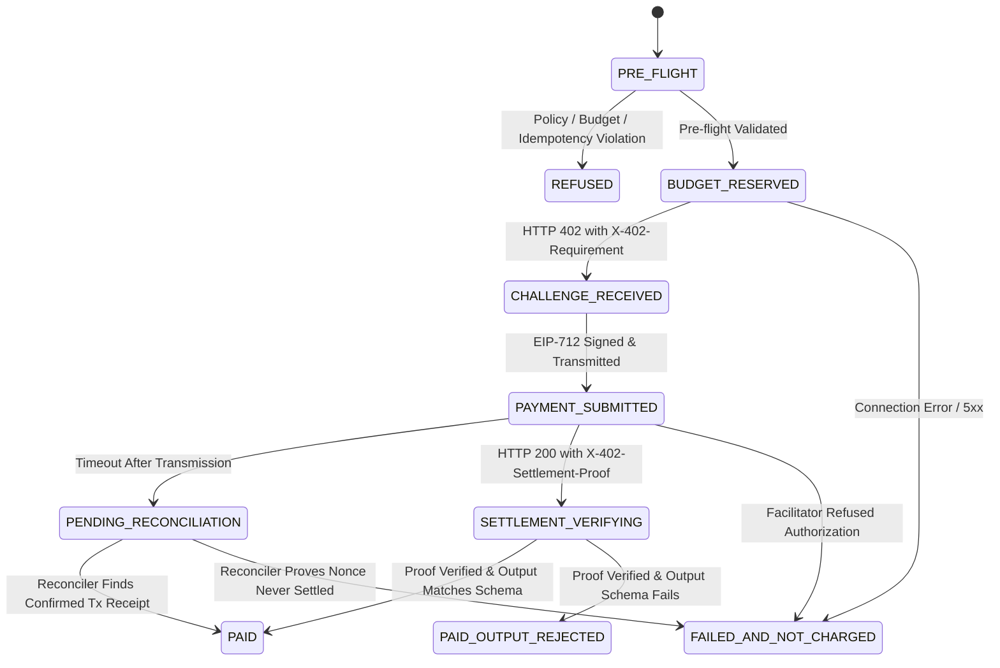

# Payment Engine Frozen Contract Specification (Member 1)

**Document ID:** DI06-CONTRACT-M1-001  
**Project:** DI-06 Pay-per-Call Agent Economy  
**Author:** Member 1 (Payment Engine & Security)  
**Target Consumers:** Member 3 (Buyer Agent), Member 4 (Ledger & Database), Member 2 (Sellers)  
**Status:** `FROZEN CONTRACT` (Phase 1 Baseline Certified)  

---

## 1. Scope, Ownership & Authority Boundaries

Member 1 owns the payment execution layer ([`backend/payments/`](file:///c:/Users/ASUS/Desktop/AgentMarketPlace/backend/payments/)).

### Authority Rules
1. **Exclusive Initiator:** Member 1 is the **sole application layer** authorized to construct payment authorizations, initiate paid HTTP calls, and issue settlement proofs.
2. **Untrusted Client Inputs:** The buyer agent (Member 3) invokes `execute_paid_call()`. The buyer is **strictly prohibited** from passing or overriding pricing, token addresses, recipients, or network configurations through request payloads.
3. **Trusted Catalog as Source of Truth:** All monetary amounts, recipient addresses (`payTo`), token contracts, and network strings are resolved directly from the trusted `ServiceCatalog` (`backend/registry/service_catalog.py`).

---

## 2. Public Entrypoint Interface (`execute_paid_call`)

### Python Interface Signature (`VERIFIED`)
```python
async def execute_paid_call(
    task_id: str,
    call_id: str,
    service_id: str,
    input_payload: Dict[str, Any],
    idempotency_key: str,
    task_budget_manager: Optional[BudgetManager] = None,
) -> PaidCallResult:
    """Executes an autonomous x402 v2 payment-settled service call.
    
    Args:
        task_id: Unique correlation identifier for the parent buyer task session.
        call_id: Unique step/call identifier within the task plan.
        service_id: Identifier of the target service in the trusted catalog.
        input_payload: JSON-serializable parameters required by the seller endpoint.
        idempotency_key: Client-generated UUID ensuring single-execution semantics.
        task_budget_manager: Optional task-scoped budget manager for atomic reservation.
        
    Returns:
        PaidCallResult: Typed Pydantic model containing terminal status,
                        agreed cost in base units, settlement proof, and seller output.
    """
```

### Parameter Validation Constraints
| Field | Type | Validation Rules | Description |
|---|---|---|---|
| `task_id` | `str` | Format `^[a-zA-Z0-9_\-]{8,64}$` | Correlation across composite buyer task steps. |
| `call_id` | `str` | Format `^[a-zA-Z0-9_\-]{8,64}$` | Unique identifier for the individual planned call. |
| `service_id` | `str` | Must exist in `ServiceCatalog` | Lookup key for price, recipient, and endpoint. |
| `input_payload` | `Dict[str, Any]` | Conforms to service's `input_schema` | Serialized JSON payload passed to seller. |
| `idempotency_key` | `str` | Non-empty string (UUID recommended) | In-memory deduplication key (durable persistence deferred to Phase 2). |

---

## 3. Payment Result Schema (`PaidCallResult`)

```python
class PaidCallResult(BaseModel):
    task_id: str = Field(..., description="Parent task correlation identifier")
    call_id: str = Field(..., description="Unique step call identifier")
    service_id: str = Field(..., description="Target service identifier")
    request_id: str = Field(..., description="Unique payment request identifier (req_*)")
    status: PaymentStatus = Field(..., description="Terminal or suspense payment status")
    amount_base_units: int = Field(default=0, description="Amount charged in integer token atomic units (1 USDC = 1,000,000)")
    amount_usdc: str = Field(default="0.000000", description="Decimal string representation of amount")
    token_address: str = Field(default=USDC_BASE_SEPOLIA, description="Settlement token contract address")
    network: str = Field(default=NETWORK_BASE_SEPOLIA, description="CAIP-2 network identifier")
    seller_recipient: str = Field(..., description="Recipient wallet address (payTo)")
    tx_hash: Optional[str] = Field(default=None, description="Base Sepolia on-chain transaction hash")
    settlement_proof: Optional[str] = Field(default=None, description="Facilitator receipt ID or cryptographic proof")
    seller_output: Optional[Dict[str, Any]] = Field(default=None, description="Verified output from seller endpoint")
    latency_ms: float = Field(default=0.0, description="Total call latency in milliseconds")
    error_code: Optional[str] = Field(default=None, description="Standard machine-readable error code if failed")
    error_message: Optional[str] = Field(default=None, description="Sanitized diagnostic error explanation")
    settled_at: Optional[datetime] = Field(default=None, description="Timestamp of confirmed settlement")
```

---

## 4. Payment States & Transition Rules

### Lifecycle Status Definitions
| Status | Serialized String | Nature | Definition & Evidence Criteria |
|---|---|---|---|
| `paid` | `"paid"` | Terminal | **Settlement Verified & Output Valid:** Cryptographic facilitator receipt or on-chain tx confirmed; seller output conformed 100% to registered JSON schema. |
| `paid_output_rejected` | `"paid output rejected"` | Terminal | **Settlement Verified & Output Invalid:** Payment settled irreversibly, but seller response violated registered output schema or failed business rules. Funds were spent. |
| `refused` | `"refused"` | Terminal | **Pre-flight Policy/Budget Rejection:** Blocked before any payment signature or attempt was issued. 0 base units charged. Budget reservation released immediately. |
| `failed_and_not_charged` | `"failed and not charged"` | Terminal | **Definitive Failure Without Charge:** Facilitator refused payload, seller returned 5xx before payment processing, or signature invalid. Evidence proves 0 funds moved. Reservation released. |
| `pending_reconciliation` | `"pending reconciliation"` | Suspense | **Uncertain Outcome:** Network timeout occurred *after* payment payload was transmitted to seller/facilitator. Status cannot be assumed failed. Funds held until reconciled. |

### Permitted State Transitions


---

## 5. Monetary Accounting & Integer Arithmetic

1. **Denomination:** All accounting operates strictly on **Base Sepolia USDC** (`0x036CbD53842c5426634e7929541eC2318f3dCF7e`), having 6 decimal places.
2. **Integer Units Only:** `1 USDC = 1,000,000 base units`.
3. **No Floating-Point Math:** Floating-point arithmetic (`float`) is strictly prohibited in monetary logic. All calculations use Python `int` or `Decimal` with `ROUND_HALF_UP`.
4. **Conversions:**
   - `usdc_to_base_units("0.002") -> 2000`
   - `base_units_to_usdc(2000) -> "0.002000"`

---

## 6. Idempotency Guarantees: Current vs Phase 2

| Feature | Current Phase 1 Baseline (`VERIFIED`) | Target Phase 2 Requirement |
|---|---|---|
| **Storage Engine** | In-memory `IdempotencyStore` (`_idempotency_cache`) | Persistent SQLite / PostgreSQL table `idempotency_records` (Member 4) |
| **Payload Binding** | Canonical SHA-256 JSON hashing (`compute_payload_hash`) | Persisted alongside `idempotency_key` |
| **Identical Key + Payload** | Returns cached `PaidCallResult` without re-execution | Returns persisted result |
| **Identical Key + Mutated Payload** | Rejects with `IdempotencyConflictError` (`HTTP 409`) | Rejects with `IdempotencyConflictError` (`HTTP 409`) |
| **Process Crash Recovery** | In-memory cache is lost upon restart | Persisted across worker crashes and restarts |

---

## 7. Standard Error Codes

All domain errors emitted by Member 1 use these standardized codes:

| Error Code | HTTP Status | Meaning | Retry Policy |
|---|---|---|---|
| `SERVICE_NOT_FOUND` | 404 | Service ID does not exist in registry. | Do not retry. |
| `SERVICE_DISABLED` | 400 | Service is marked inactive (`is_active=False`). | Do not retry. |
| `PAYMENT_POLICY_VIOLATION` | 400 | Quoted price, token, network, or recipient mismatch. | Do not retry. |
| `BUDGET_EXCEEDED` | 400 | Insufficient available base units in task budget. | Do not retry without budget increase. |
| `IDEMPOTENCY_CONFLICT` | 409 | Idempotency key reused with mutated payload. | Generate new key or restore original payload. |
| `REPLAY_DETECTED` | 409 | Nonce already consumed in previous transaction. | Request fresh challenge. |
| `SETTLEMENT_TIMEOUT` | 504 | Operation timed out after payload transmission. | **Do NOT retry.** Escalate to reconciliation. |
| `SETTLEMENT_VERIFICATION_FAILED` | 502 | Proof header could not be verified. | Reconcile against Base Sepolia RPC. |
| `OUTPUT_SCHEMA_INVALID` | 422 | Seller response violated JSON schema. | Penalize seller; do not re-pay. |

---

## 8. Application Transport Headers vs Official x402 Protocol

The repository coordinates payment flows using custom application transport headers, NOT certified official x402 protocol headers:

| Protocol Stage | Direction | Header Name | Content / Schema |
|---|---|---|---|
| **1. Challenge** | Seller -> Buyer Adapter | `X-402-Requirement` | JSON-serialized `PaymentRequirement` (`network`, `token`, `payTo`, `amount`, `nonce`, `service_id`). |
| **2. Payment Submission** | Buyer Adapter -> Seller | `X-402-Payment-Payload` | JSON-serialized `PaymentPayload` (`authorization` parameters, `signature`, `buyer_address`). |
| **2. Deduplication** | Buyer Adapter -> Seller | `Idempotency-Key` | String UUID guaranteeing request uniqueness. |
| **3. Settlement Receipt** | Seller -> Buyer Adapter | `X-402-Settlement-Proof` | On-chain tx hash (`0x...`) or facilitator receipt identifier string. |

> [!WARNING]
> **Official Protocol Compatibility Status: `NOT VERIFIED`**
> These custom `X-402-*` headers represent internal application transport contracts codified across Member 1, Member 2, and `backend/main.py` CORS configuration. Official x402 protocol compatibility is **`NOT VERIFIED`** because the official `x402` SDK package is not installed. Transport bridging to official x402 standards (e.g. `WWW-Authenticate: L402` or `PAYMENT-REQUIRED`) will be evaluated upon package installation in Phase 2.

---

## 9. Shared Ledger Gap & Suspense Store Boundary

1. **Current Schema Constraint:** `backend/shared/constants.py` defines `LedgerStatus` with exactly four terminal statuses:
   `paid`, `paid output rejected`, `refused`, and `failed and not charged`.
2. **Suspense Store Isolation:** To prevent uncertain in-flight payments from being recorded falsely as terminal failures (`refused`) or terminal successes (`paid`), `PaymentService` intercepts `PaymentStatus.PENDING_RECONCILIATION`.
3. **Behavior:**
   - Uncertain attempts are retained in `PaymentService._pending_reconciliations` in-memory suspense registry.
   - Task budget reservations are held and NOT released.
   - The shared `ledger_repo` is NOT updated until definitive confirmation or failure is confirmed by `SettlementVerifier.reconcile_uncertain_attempt()`.
4. **Cross-Team Blocker:** Adding `PENDING_RECONCILIATION = "pending reconciliation"` to `backend/shared/constants.py` requires formal sign-off from Setup Lead and Member 4 (tracked in Phase 2 checklist).
