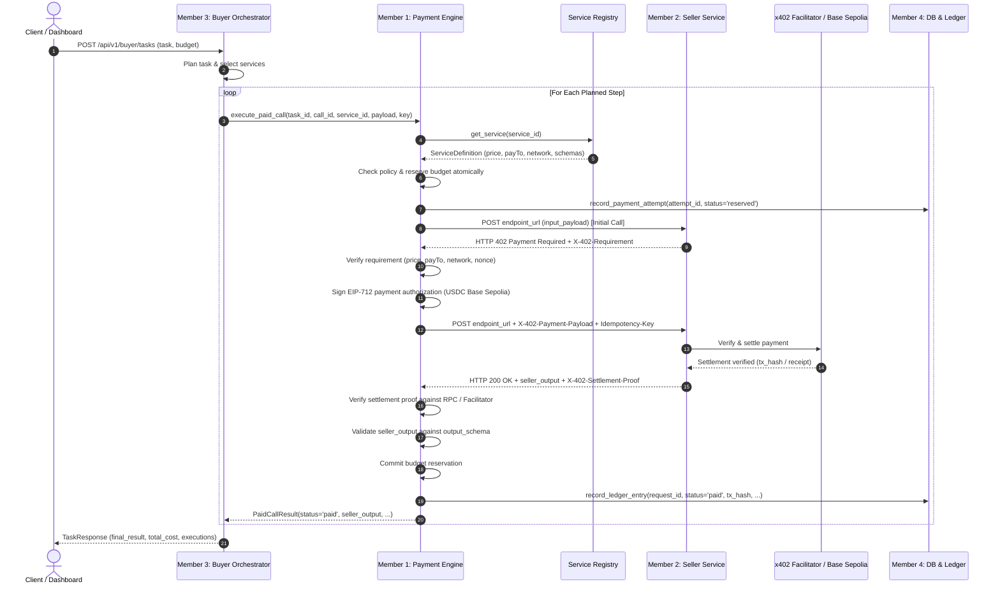

# Cross-Team Integration Specification (Member 1)

**Document ID:** DI06-INTEGRATION-M1-001  
**Project:** DI-06 Pay-per-Call Agent Economy  
**Author:** Member 1 (Payment Engine & Security)  
**Stakeholders:** Member 2 (Sellers), Member 3 (Buyer), Member 4 (Ledger/DB), Setup Lead  
**Status:** `FROZEN CROSS-TEAM CONTRACT` (Phase 1 Baseline Certified)  

---

## 1. End-to-End System Sequence Diagram



---

## 2. Official Protocol Headers vs Application Header Mapping

| Protocol Concept | Application Header Name (`VERIFIED`) | Official x402 Standard Header Name | Content / Encoding |
|---|---|---|---|
| **Challenge Specification** | `X-402-Requirement` | `PAYMENT-REQUIRED` | JSON string: `{version, network, token, amount, payTo, nonce, service_id}` |
| **Payment Authorization** | `X-402-Payment-Payload` | `PAYMENT-SIGNATURE` | JSON string: `{authorization, signature, buyer_address}` |
| **Settlement Proof** | `X-402-Settlement-Proof` | `PAYMENT-RECEIPT` | String: Base Sepolia transaction hash (`0x...`) or facilitator receipt ID |
| **Idempotency Key** | `Idempotency-Key` | `Idempotency-Key` | Client UUID string |

Both Member 1 and Member 2 currently use the application headers (`X-402-*`), which are exposed via CORS in [`backend/main.py`](file:///c:/Users/ASUS/Desktop/AgentMarketPlace/backend/main.py#L44-L56). 

> [!IMPORTANT]
> **SDK Compatibility Notice:** The repository currently binds to explicit application transport headers (`X-402-*`). Official x402 Python SDK transport compatibility (e.g., standard `WWW-Authenticate: L402` or `PAYMENT-REQUIRED`) will be tested and bridged in Phase 2 once the official `x402` package is installed and its exact protocol version verified. No premature claim of official SDK compatibility is made in Phase 1.

---

## 3. Member 2 (Seller Agents) Dependencies & Contract

### Endpoint Responsibilities
1. **Initial Call (No Headers):** Must return `HTTP 402 Payment Required` containing header `X-402-Requirement`.
2. **Challenge Nonce:** Must generate a cryptographically random, single-use nonce for each 402 response.
3. **Price Integrity:** The `amount` field in the requirement header must strictly equal the service's listed `price_base_units` in the registry. Quoting higher amounts will be refused as price gouging.
4. **Execution Guarantees:**
   - If payment payload verification fails: return `HTTP 402` or `HTTP 400` without executing business logic.
   - If payment verification succeeds: execute business logic and return `HTTP 200 OK` with header `X-402-Settlement-Proof`.
5. **Output Schema Fulfillment:** Output body must conform 100% to the registered `output_schema`. Missing required fields will trigger a `paid_output_rejected` status and penalize seller reputation.

---

## 4. Member 3 (Buyer Agent) Integration Contract

### How Buyer Invokes Payment Engine
In [`backend/buyer/buyer_agent.py`](file:///c:/Users/ASUS/Desktop/AgentMarketPlace/backend/buyer/buyer_agent.py), Member 3 invokes Member 1's payment engine:

```python
from backend.payments.service import payment_service

# Inside BuyerAgent.execute_task():
paid_result = await payment_service.execute_paid_call(
    task_id=task_id,
    call_id=f"step_{step.step_number}",
    service_id=step.service_id,
    input_payload=step.input_data,
    idempotency_key=f"{task_id}_{step.step_number}_{step.service_id}",
    task_budget_manager=budget_mgr
)

# Map result into composite task execution step:
executions.append(ExecutionStep(
    step=step.step_number,
    service_id=paid_result.service_id,
    request_id=paid_result.request_id,
    price_paid_usdc=paid_result.amount_usdc,
    tx_hash=paid_result.tx_hash,
    status=paid_result.status.value,
    latency_ms=paid_result.latency_ms,
    output=paid_result.seller_output,
    error=paid_result.error_message
))
```

### Buyer Contract Rules
1. **No Direct Signing:** Member 3 does **not** import Web3 or private keys.
2. **No Blind Retries:** If `paid_result.status == PaymentStatus.PENDING_RECONCILIATION`, the buyer agent must **not** retry the call with a new idempotency key. It must wait for reconciliation.
3. **Graceful Degradation:** If `paid_result.status == PaymentStatus.REFUSED` due to budget, the buyer agent halts planning and returns a transparent cost explanation.

---

## 5. Member 4 (Database & Ledger) Persistence Contract

Member 4 owns `backend/database/` and `backend/ledger/`. Member 1 defines the following repository specifications for Phase 2 implementation.

### Required Tables
1. **`payment_attempts`**:
   - `attempt_id` (PK, string)
   - `task_id` (string, indexed)
   - `call_id` (string)
   - `service_id` (string, indexed)
   - `idempotency_key` (string, unique, indexed)
   - `request_hash` (string, SHA-256)
   - `amount_base_units` (integer)
   - `pay_to` (string)
   - `nonce` (string, nullable)
   - `status` (string, indexed)
   - `tx_hash` (string, nullable, indexed)
   - `settlement_proof` (string, nullable)
   - `error_reason` (text, nullable)
   - `created_at` (datetime)
   - `updated_at` (datetime)

2. **`budget_reservations`**:
   - `reservation_id` (PK, string)
   - `task_id` (string, indexed)
   - `amount_base_units` (integer)
   - `status` (string: `reserved`, `committed`, `released`)
   - `created_at` (datetime)

### Repository Interface Requirements
```python
class IPaymentPersistenceRepository(ABC):
    @abstractmethod
    def get_or_create_attempt(
        self, idempotency_key: str, task_id: str, call_id: str, service_id: str, request_hash: str, amount_units: int
    ) -> Tuple[PaymentAttemptModel, bool]:
        """Atomically returns existing attempt or creates new row with status='reserved'."""
        pass

    @abstractmethod
    def update_attempt_status(
        self, attempt_id: str, status: str, tx_hash: Optional[str] = None, proof: Optional[str] = None, error: Optional[str] = None
    ) -> None:
        """Updates payment attempt record with confirmed settlement evidence."""
        pass

    @abstractmethod
    def reserve_task_budget(self, task_id: str, reservation_id: str, amount_units: int) -> bool:
        """Atomically acquires row-level lock on task budget and records reservation."""
        pass

    @abstractmethod
    def release_task_budget(self, reservation_id: str) -> None:
        """Releases reservation back to available budget if execution fails without charge."""
        pass

    @abstractmethod
    def commit_task_budget(self, reservation_id: str, actual_spent_units: int) -> None:
        """Converts reservation into permanent spent accounting upon settlement."""
        pass
```

### Zero-Secrets Boundary
- No private keys, wallet mnemonics, or raw authorization headers are permitted to be stored in database tables or logs.

---

## 6. Shared Identifiers Summary

| Identifier | Generation Rule | Scope | Purpose |
|---|---|---|---|
| `task_id` | `task_<12-hex>` | Global Task | Correlates all steps in a user task session. |
| `call_id` | `call_<number>` or `step_<number>` | Task Step | Identifies the execution step. |
| `service_id` | Slug e.g. `data_001` | Registry | Primary key of the seller microservice. |
| `request_id` | `req_<12-hex>` | Payment Attempt | Unique identifier for the HTTP request in the audit ledger. |
| `idempotency_key` | Client UUID / Deterministic string | Attempt | Prevents duplicate payments for the same call. |
| `tx_hash` | `0x<64-hex>` | Blockchain | On-chain settlement transaction on Base Sepolia. |
