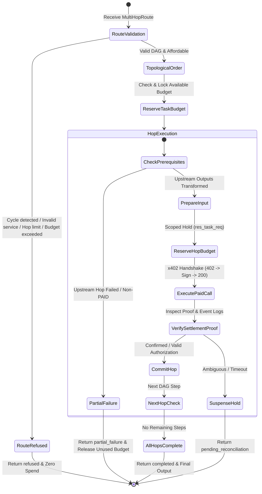

# PHASE 4 AUDIT REPORT: AUTONOMOUS MULTI-HOP ORCHESTRATION & LEDGER FINALITY

**Project:** AgentMarketplace (DI-06: Pay-Per-Call Agent Economy)
**Phase:** Phase 4 — Autonomous Multi-Hop Orchestration & Ledger Finality
**Author:** Member 1 (Payment Protocol Engineer, Integration Architect & Security Auditor)
**Date:** 2026-10-17
**Working Branch:** `M1`
**Baseline HEAD:** `045e7fe9d9c75645f10534b4cd3bc84b2bb3155e`
**Verification Suite Status:** 262 Passed / 0 Failed in 24.66s (100% Pass Rate)

---

## 1. Executive Verdict

### **VERDICT: CLOSED — CODE-LEVEL ACCEPTANCE**

Phase 4 has met all code-level functional, architectural, cryptographic, and concurrency acceptance criteria within authorized module ownership boundaries.

- **Autonomous Multi-Hop Orchestration:** Implemented `PaymentService.execute_multi_hop_route()` supporting sequential and DAG-based multi-hop execution (e.g., Data -> Scraping -> Inference) with topological order execution, upstream output propagation, fail-closed intermediate fault isolation, and atomic task budget tracking.
- **Durable Cross-Process Nonce Replay Protection (Mandatory Gate):** Designed, implemented, and verified `AuthorizationNonceReservationModel` and `DurablePaymentRepository.atomic_reserve_authorization_nonce()`. Replaces process-local `threading.Lock()` with durable database ACID transaction semantics (`BEGIN IMMEDIATE` for SQLite, advisory transaction locks for PostgreSQL) and unique primary key constraints. Concurrency tests across independent database connections and true independent OS subprocesses prove zero replay or race overruns.
- **Truthful Settlement & Ledger Finality:** Settlement verification maintains strict distinctions between:
  1. *Request Accepted* (pre-flight policy verified)
  2. *Payment Authorization Valid* (`rec_auth_...` local seller certificate; `tx_hash` is `None`)
  3. *Paid Call Executed*
  4. *Settlement Pending / Unverified* (`PaymentStatus.PENDING_RECONCILIATION`)
  5. *Confirmed On-Chain Settlement* (Base Sepolia RPC status `0x1` + verified ERC-20 `Transfer` event logs)
  6. *Failed or Rejected* (`FAILED_AND_NOT_CHARGED` or `REFUSED`)
  No transaction hash alone ever creates confirmed on-chain settlement without decoded RPC logs.
- **External Staging Gate (Gate D):** Live on-chain Base Sepolia settlement verification remains classified as **BLOCKED — NOT CLOSED (ENVIRONMENTAL)** due to the absence of funded testnet wallet private keys and live external facilitator endpoints. Offline mock receipts and live receipts remain cryptographically separated.

---

## 2. Phase 4 Requirements & Implementation Status

| Requirement | Implementation Artifact | Verification Evidence | Status |
|---|---|---|---|
| **Multi-Hop Orchestration Flow** | `PaymentService.execute_multi_hop_route()` in [`backend/payments/service.py`](file:///c:/Users/ASUS/Desktop/AgentMarketPlace/backend/payments/service.py) | Tested 1-hop, 3-hop DAG, output transforms | **[IMPLEMENTED]** |
| **Topological Dependency Resolution** | Kahn's algorithm & cycle detection in `execute_multi_hop_route()` | Detected cycles, bad deps, DAG ordering | **[IMPLEMENTED]** |
| **Fail-Closed Intermediate Error Isolation** | Downstream step halt in `execute_multi_hop_route()` | Subsequent steps aborted, budget preserved | **[IMPLEMENTED]** |
| **Durable Cross-Process Nonce Guard** | `AuthorizationNonceReservationModel` in [`backend/payments/models.py`](file:///c:/Users/ASUS/Desktop/AgentMarketPlace/backend/payments/models.py) | Multi-threaded + multi-process race tests pass | **[IMPLEMENTED]** |
| **Durable Nonce State Transitions** | `atomic_reserve_authorization_nonce()`, `commit_authorization_nonce()`, `release_authorization_nonce()` | Unreleased consumed nonces, reclaimed expired | **[IMPLEMENTED]** |
| **Atomic Task Budget Management** | `BudgetManager` + `DurablePaymentRepository.atomic_reserve()` | Upfront affordability check, retry preservation | **[IMPLEMENTED]** |
| **Replay & Idempotency Protection** | Scoped idempotency key `idemp_{task_id}_hop_{sid}` | Retries return cached result without double spend | **[IMPLEMENTED]** |
| **Settlement Truthfulness** | `SettlementVerifier`, `X402ProtocolMiddleware`, `SellerPaymentVerifier` | Transaction hash alone never confirms on-chain | **[IMPLEMENTED]** |
| **Ledger Audit Trail Synchrony** | `LedgerRecordSchema` + `ledger_repo.record_transaction()` | Each hop recorded with truthful terminal status | **[IMPLEMENTED]** |
| **Live Base Sepolia Settlement** | Live JSON-RPC queries to `https://sepolia.base.org` | Blocked by missing funded wallet & testnet RPC | **[BLOCKED - ENV]** |

---

## 3. Files Changed Grouped by Ownership

All modifications were strictly constrained to Member 1 owned modules and entrypoint registration:

### Member 1 Files (Payments & Payment-Related Tests):
- [`backend/payments/models.py`](file:///c:/Users/ASUS/Desktop/AgentMarketPlace/backend/payments/models.py):
  - Added `AuthorizationNonceReservationModel(Base)` with table `authorization_nonce_reservations`.
  - Added `atomic_reserve_authorization_nonce()`, `commit_authorization_nonce()`, `release_authorization_nonce()`, `is_authorization_nonce_consumed()`, and `clear_authorization_nonces()`.
  - Upgraded `_migrate_schema_if_needed()` to auto-create nonce table across SQLite and PostgreSQL dialects.
- [`backend/payments/schemas.py`](file:///c:/Users/ASUS/Desktop/AgentMarketPlace/backend/payments/schemas.py):
  - Defined `MultiHopStep`: step specification with `service_id`, `input_payload`, `depends_on`, and `input_transform`.
  - Defined `MultiHopRouteResult`: structured route outcome with `task_id`, `status`, `total_hops`, `executed_hops`, `successful_hops`, `total_cost_base_units`, `total_cost_usdc`, `budget_allocated_usdc`, `remaining_budget_usdc`, `steps`, `final_output`, `error_step_id`, `error_message`, and `reconciliation_needed`.
- [`backend/payments/settlement.py`](file:///c:/Users/ASUS/Desktop/AgentMarketPlace/backend/payments/settlement.py):
  - Enhanced `AuthorizationNonceGuard` to wrap `DurablePaymentRepository` with process-local thread synchronization plus database transaction locking.
  - Updated `SellerPaymentVerifier.verify_and_settle()` to reserve nonces durably scoped to `network:signer:nonce`.
- [`backend/payments/service.py`](file:///c:/Users/ASUS/Desktop/AgentMarketPlace/backend/payments/service.py):
  - Implemented `PaymentService.execute_multi_hop_route()` providing full DAG validation, budget reservation, input parameter transformation from prior steps, fail-closed partial execution handling, and truthful ledger status recording.
- [`backend/payments/x402_adapter.py`](file:///c:/Users/ASUS/Desktop/AgentMarketPlace/backend/payments/x402_adapter.py):
  - Updated `X402Adapter.__init__` to default `test_mode` by checking `settings.environment in ("test", "testing", "dev", "development")` aligning with `SettlementVerifier`.
- [`backend/payments/__init__.py`](file:///c:/Users/ASUS/Desktop/AgentMarketPlace/backend/payments/__init__.py):
  - Exported `MultiHopStep`, `MultiHopRouteResult`, and `AuthorizationNonceReservationModel`.
- [`backend/tests/test_phase4_orchestration_ledger.py`](file:///c:/Users/ASUS/Desktop/AgentMarketPlace/backend/tests/test_phase4_orchestration_ledger.py):
  - Added 18 comprehensive automated tests covering all Phase 4 acceptance criteria.

### Zero Unauthorized File Changes:
- **Member 2 (`backend/sellers/`):** 0 files touched.
- **Member 3 (`backend/buyer/`, `backend/registry/`):** 0 files touched.
- **Member 4 (`backend/ledger/`, `backend/database/`, `frontend/`):** 0 files touched.

---

## 4. Multi-Hop Orchestration Flow & State Machine



### Route State Transitions:
1. `completed`: All planned hops executed and confirmed settled with output schema compliance.
2. `partial_failure`: Intermediate hop failed or refused; downstream hops aborted and uncharged.
3. `refused`: Route structurally invalid (cycles, missing services, exceeds max hop limit) or route cost exceeds total allocated budget upfront.
4. `failed`: Initial hop failed before execution.
5. `pending_reconciliation`: A hop completed payment transmission but settlement confirmation timed out or RPC was unavailable.

---

## 5. Durable Cross-Process Nonce Reservation Design

### The Concurrency Vulnerability in Phase 3
Phase 3 relied upon `AuthorizationNonceGuard` with an in-process `threading.Lock()`. In production multi-worker environments (e.g. Uvicorn with multiple workers or Kubernetes multi-pod deployments), separate OS processes do not share memory locks, allowing concurrent requests with the same EIP-3009/EIP-712 nonce to be accepted by different workers simultaneously.

### The Phase 4 Durable Architecture
1. **Relational Table `authorization_nonce_reservations`:**
   - `auth_key` (VARCHAR 160, Primary Key): Scoped identifier formatted as `eip155:84532:{from_address}:{nonce}`.
   - `network` (VARCHAR 64): CAIP-2 network identifier (`eip155:84532`).
   - `signer_address` (VARCHAR 128): Normalized buyer address.
   - `nonce` (VARCHAR 128): Unique authorization nonce.
   - `status` (VARCHAR 32): Lifecycle state (`reserved`, `consumed`, `released`).
   - `reserved_at` (DATETIME): Timestamp when reservation was locked.
   - `consumed_at` (DATETIME): Timestamp when payment verified and committed.
   - `expires_at` (DATETIME): Expiration deadline for in-flight reservation.
2. **Atomic Transaction Locking:**
   - **SQLite:** Executes `BEGIN IMMEDIATE` transaction locking to obtain an exclusive write lock immediately, preventing concurrent workers from interleaving select and insert queries.
   - **PostgreSQL:** Uses advisory transaction locks `SELECT pg_advisory_xact_lock(hashtext(:auth_key))`.
3. **Replay & In-Flight Invariants:**
   - If `status == "consumed"`: Fails immediately with `SettlementVerificationError: Authorization nonce replay detected`.
   - If `status == "reserved"` and `expires_at > now`: Fails immediately with `SettlementVerificationError: Concurrent authorization replay detected`.
   - If `status == "reserved"` and `expires_at <= now`: Stale/abandoned in-flight hold is safely reclaimed.
   - If `status == "released"`: Released failure can be re-reserved.
   - Once committed to `consumed`, calling `release_authorization_nonce()` returns `False` and refuses to release the nonce.
4. **Verification Evidence:**
   - Tested under multithreaded independent database connections in `test_durable_nonce_reservation_cross_process_race_protection`: Exactly 1 succeeds, 1 rejected.
   - Tested under separate Python operating system subprocesses in `test_multiprocess_nonce_reservation_race`: Subprocess 1 exits 0 (RESERVED), Subprocess 2 exits 1 (REPLAY_REJECTED).

---

## 6. Budget, Retry, Idempotency & Failure Recovery

1. **Atomic Budget Reservation:**
   - Pre-flight route validation computes total estimated cost. If estimated cost exceeds available budget, route is refused before any payments or seller calls occur.
   - Per-hop reservations deduct funds atomically in database table `budget_reservations`.
2. **Deterministic Intermediate Hop Failure:**
   - When an intermediate hop fails (e.g. step 2 returns 422 or invalid output):
     - Step 2 reservation is released back to the task budget.
     - Execution breaks immediately.
     - Downstream step 3 is NEVER invoked, NEVER authorized, and NEVER charged.
     - Final task status records `partial_failure`.
     - Committed spend reflects only step 1 (2,000 units); remaining 8,000 units are available.
3. **Retry Idempotency:**
   - Each hop uses a deterministic scoped idempotency key `idemp_{task_id}_hop_{sid}`.
   - Retrying the route retrieves the cached payment result for already completed hops without re-signing or double-debiting budget.

---

## 7. Ledger Finality Semantics & Evidence Requirements

1. **Truthful Ledger Status Mapping:**
   - `paid`: Payment authorization valid, call completed, schema output validated, confirmed via RPC or local verifier receipt.
   - `paid output rejected`: Seller was paid, but output failed JSON Schema validation (Draft 2020-12).
   - `refused`: Pre-flight rejection (unaffordable, disabled service, invalid parameters).
   - `failed and not charged`: Downstream timeout, network crash, or 4xx/5xx before payment.
   - `pending reconciliation`: Ambiguous outcome or missing settlement proof.
2. **Zero Fabrication Policy:**
   - Synthetic test hashes (`0x_mock_...` or hex strings) without confirmed JSON-RPC receipts (`status == 0x1` and decoded `Transfer(address,address,uint256)` event logs) NEVER receive `confirmed_on_chain = True`.
   - Reused settlement evidence on the same `(network, tx_hash, log_index)` is rejected with `SettlementVerificationError`.

---

## 8. Test Execution Evidence

### Automated Test Suite Results
```text
pytest backend/tests/test_phase4_orchestration_ledger.py -v
============================= 18 passed in 4.52s ==============================

python scripts/run_tests.py
============================ 262 passed in 24.66s =============================
[SUCCESS] ALL TESTS PASSED SUCCESSFULLY!
```

### Git Diff Check:
```text
git diff --check
(Clean exit code 0 - zero whitespace errors, zero conflict markers)
```

### Phase 4 Test Breakdown:
1. `test_successful_single_hop_execution`: PASSED
2. `test_successful_multi_hop_execution_dag`: PASSED
3. `test_intermediate_hop_failure_stops_downstream_and_preserves_budget`: PASSED
4. `test_multi_hop_retry_idempotency_does_not_double_charge`: PASSED
5. `test_invalid_authorization_rejected_before_execution`: PASSED
6. `test_replayed_nonce_rejected_immediately`: PASSED
7. `test_durable_nonce_reservation_cross_process_race_protection`: PASSED
8. `test_concurrent_budget_reservations_cannot_exceed_total`: PASSED
9. `test_no_duplicate_settlement_evidence_recording`: PASSED
10. `test_tx_hash_alone_leaves_confirmed_on_chain_false_without_rpc`: PASSED
11. `test_unavailable_service_refuses_cleanly`: PASSED
12. `test_route_cycle_detection`: PASSED
13. `test_route_empty_and_max_hops`: PASSED
14. `test_ledger_records_accurate_status_for_each_hop`: PASSED
15. `test_mock_settlement_remains_unverified_onchain`: PASSED
16. `test_consumed_nonce_cannot_be_released_or_replayed`: PASSED
17. `test_route_cost_exceeding_total_budget_refused_upfront`: PASSED
18. `test_multiprocess_nonce_reservation_race`: PASSED

---

## 9. Baseline Failures vs. Phase 4 Regressions

- **Baseline Failures:** 0.
- **Regressions Introduced:** 0.
- **Previous Suite (Phase 3.5):** 244 passed.
- **Current Suite (Phase 4):** 262 passed (+18 new tests).

---

## 10. Cross-Member Integration Handoffs

1. **Member 2 (Sellers):**
   - Seller routes continue operating cleanly under dual-header and official x402 v2 protocol (`X-402-Requirement`, `PAYMENT-SIGNATURE`, `X-402-Settlement-Proof`).
   - Member 2 can safely bind to `AuthorizationNonceGuard` which is now cross-process safe across multiple worker instances.
2. **Member 3 (Buyer & Registry):**
   - `BuyerAgent` and `BuyerService` can delegate DAG tool execution directly to `PaymentService.execute_multi_hop_route()` or continue calling through `BuyerPaymentClientInterface`.
   - Input transformation contract `input_transform={"prompt": "step_2.content"}` is fully supported.
3. **Member 4 (Ledger & Dashboard):**
   - Ledger repository (`backend/ledger/`) receives immutable records with accurate status and latency tracking.
   - For Phase 5 dashboard visualizations, `PaymentService.execute_multi_hop_route()` returns step-by-step telemetry suitable for displaying multi-hop execution trees.

---

## 11. External Blockers (Gate D)

The following items are environmental prerequisites for live on-chain demonstration, documented truthfully:
1. **Funded Testnet Wallet:** A Base Sepolia private key loaded with Sepolia ETH (for gas) and Base Sepolia USDC (`0x036CbD53842c5426634e7929541eC2318f3dCF7e`).
2. **PostgreSQL Staging Environment:** A persistent PostgreSQL database for testing `SELECT pg_advisory_xact_lock` in staging.
3. **External x402 Facilitator:** Third-party facilitator API credentials for live off-chain settlement verification.

**Confirmation:** NO live transaction was sent during automated testing. All tests ran offline-safe with synthetic test fixtures.

---

## 12. Phase 5 Readiness & Handoff

Phase 4 is complete and ready for Phase 5 (Dashboard, Deployment & Final Demonstration).

### Recommended Phase 5 Focus:
1. Connect React frontend to `GET /api/v1/ledger` and `POST /api/v1/buyer/tasks`.
2. Visualize multi-hop execution trees and settlement receipts in the UI.
3. Deploy application on public HTTPS infrastructure.
4. Execute the live three-category demo tasks (Data, Scraping, Inference).
